# Deploying Apps to Azure Container App

:::info Reusable Workflow

| Workflow                        | Version | Source                                                                                                                              |
| ------------------------------- | ------- | ----------------------------------------------------------------------------------------------------------------------------------- |
| **Release Azure Container App** | v1      | [`release-azure-containerapp-v1.yaml`](https://github.com/pagopa/dx/blob/main/.github/workflows/release-azure-containerapp-v1.yaml) |

:::

This documentation covers the Container App Release reusable workflow.

## How It Works

The workflow performs the following steps:

1. Build and push the Docker image to the registry using the `docker-build-push`
   action
2. Determine the Container App’s
   [revision mode](https://learn.microsoft.com/en-us/azure/container-apps/revisions#revision-modes):
   **Single** or **Multiple**
3. In **Single** mode, deploy the new image; Azure automatically routes 100% of
   traffic to the new revision when it is ready
4. In **Multiple** mode (canary rollout):
    1. Create a new revision with the updated image
    2. Wait until the new revision reports **Healthy** status for the app
      (according to configured probes)
    3. Assign the stable `staging` revision label for testing the candidate
    4. To implement a canary deployment, you can set up
      [a custom script](#implementing-a-canary-test-script) within your pipeline
      that guides the deployment process using its output, in JSON format (more
      details below):
        - Use a `swap` flag to cut over immediately (100% traffic to new revision)
        - Use `nextPercentage` and `afterMs` to schedule gradual rollouts
    5. If no script is provided, perform a full switch (100% to new revision)
5. After successful switch, deactivate the old revision and remove `staging`
6. In case of failure, the new revision is deactivated, while the old revision
   remains active

```mermaid
flowchart TD
    Start([Release workflow called]) --> Build["Build and push image<br/>or reuse supplied image tag"]
    Build --> BuildOK{"Build succeeded<br/>or was skipped?"}
    BuildOK -->|No| Failed([Workflow failed])
    BuildOK -->|Yes| ReleaseGate
    BuildOK -->|Yes, in parallel| AutoEnabled

    subgraph Approval["Approval handling"]
        AutoEnabled{"Auto-deploy enabled<br/>and not running under act?"}
        AutoEnabled -->|Yes| AutoTry["Auto-approval job attempts approval<br/>using configured reviewer token"]
        AutoTry --> AutoOK{"Approval submitted?"}
        AutoOK -->|Yes| Approved["Pending deployment approved"]
        AutoOK -->|No| Manual["Manual approval<br/>if approval is still pending"]
        AutoEnabled -->|No| Manual

        ReleaseGate["Release job environment gate<br/>Proceed when protection rules are satisfied<br/>No approval needed if none is configured"]
        Approved -.-> ReleaseGate
        Manual -.-> ReleaseGate
    end

    subgraph Revision["Deploy revision - release job"]
        ReleaseGate --> Prepare["Resolve image, log in to Azure<br/>Read Single or Multiple revision mode"]
        Prepare --> Current["Select newest ACTIVE revision"]
        Current --> Copy["Copy its template with the requested image<br/>Azure returns a candidate revision name"]
        Copy --> Same{"Candidate equals<br/>current active revision?"}

        Same -->|Yes| NoOp([Successful no-op<br/>Skip readiness and promotion])
        Same -->|No| Mode{"Revision mode?"}

        Mode -->|Multiple| Inspect{"Is the candidate inactive?"}
        Inspect -->|Yes| Activate["Explicitly activate the existing revision"]
        Inspect -->|No| Traffic
        Activate --> Traffic["Keep current revision at 100% traffic<br/>Candidate at 0%"]

        Mode -->|Single| Wait
        Traffic --> Wait["Wait for candidate to become Healthy<br/>Currently: 30 polls with 3-second sleeps"]
        Wait --> Healthy{"Healthy before timeout?"}
        Healthy -->|No| ReleaseFailure
        Healthy -->|Yes| ReadyMode{"Revision mode?"}

        ReadyMode -->|Single| SingleDone([Complete<br/>Azure manages the traffic switch<br/>No separate swap job])
        ReadyMode -->|Multiple| Label["Assign staging label to candidate"]
    end

    subgraph Promotion["Promote revision - swap job, Multiple mode only"]
        Label --> Act{"Running under act?"}
        Act -->|Yes| Staged([Candidate staged<br/>Swap job skipped])
        Act -->|No| SwapGate["Same environment gate: environment-cd<br/>Satisfy any outstanding protection rules"]
        Manual -.-> SwapGate

        SwapGate --> Rollout["Log in to Azure and promote traffic<br/>Canary script: incremental rollout<br/>No script: directly set latest to 100%"]
        Rollout --> RolloutOK{"Rollout succeeded?"}
        RolloutOK -->|No| SwapFailure
        RolloutOK -->|Yes| Finish["Remove staging label<br/>Deactivate old revision"]
        Finish --> Done([Deployment complete])
        Finish -.->|Command failure| SwapFailure
    end

    subgraph Recovery["Failure handling"]
        ReleaseFailure["Release timeout or command failure"]
        ReleaseFailure --> CanClean{"Multiple mode and<br/>valid, distinct candidate identified?"}
        CanClean -->|No| Failed
        CanClean -->|Yes| Restore

        SwapFailure["Swap job failure"] --> Restore

        Restore["Restore current revision traffic to 100%<br/>Avoid traffic operations on an inactive candidate"]
        Restore --> Active{"Is candidate still active?"}
        Active -->|Yes| Deactivate["Deactivate candidate"]
        Active -->|No| Failed
        Deactivate --> Failed
    end

    Copy -.->|Command failure| ReleaseFailure
    Activate -.->|Command failure| ReleaseFailure
    Label -.->|Command failure| ReleaseFailure
```



### Manual Deployment Approval

When the `${environment}-cd` GitHub environment is configured with protection
rules, deployments are approved automatically by default through the
`GH_TOKEN_DEPLOYMENT_APPROVAL` repository secret. Set `enable_auto_deploy` to
`false` to require a manual approval before the new revision receives traffic.

### Staging URL

In **Multiple** mode, test the healthy candidate at this stable URL, even when
it receives 0% of application traffic:

```text
https://my-app---staging.example.azurecontainerapps.io
```

The app URL remains the production endpoint. After a successful rollout and old
revision deactivation, the workflow removes the `staging` endpoint.

**Single** mode is unchanged: Azure switches traffic as soon as the new revision
is ready, so there is no pre-promotion testing window for a staging label.

### Implementing a Canary Test Script

For canary deployments, add a TypeScript (`npm`, `yarn` or `pnpm`) script to
test the new version and drive workflow behaviour. This script can check the
results of integration tests and/or monitoring metrics before outputting a
payload that influence the workflow.

The following schemas for the script output are supported:

```json
{
  "swap": true
}
```

Output such payload to immediate cutover to the new version:

- `swap`: when `true`, switches all traffic to the new revision immediately.

Instead, for gradual rollout output:

```json
{
  "nextPercentage": 50,
  "afterMs": 30000
}
```

- `nextPercentage`: percentage of users traffic that will flow to the new
  revision in the next iteration of the script.
- `afterMs`: delay in milliseconds before moving to the next iteration.

## Usage

```yaml
jobs:
  deploy:
    uses: pagopa/dx/.github/workflows/release-azure-containerapp-v1.yaml@main
    with:
      container_app: <app-name>
      resource_group_name: <resource-group>
      environment: <environment>
      enable_auto_deploy: false
      docker_image_description: "<image-description>"
```

## Notes

- Ensure the following secrets are set in your repository:
  `ARM_SUBSCRIPTION_ID`, `ARM_TENANT_ID`, `ARM_CLIENT_ID`, `GITHUB_TOKEN`, and
  `GH_TOKEN_DEPLOYMENT_APPROVAL`.
