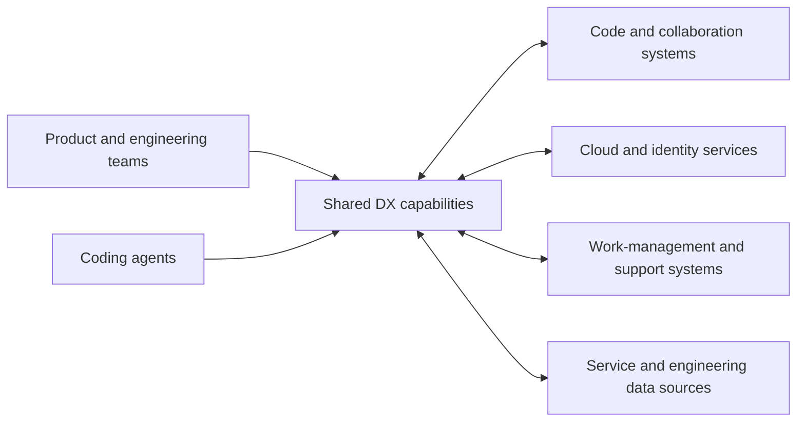
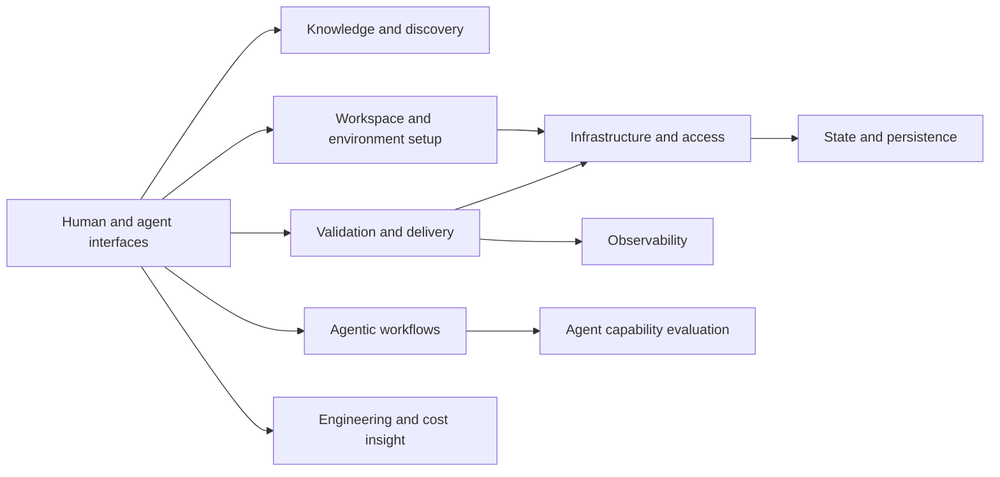
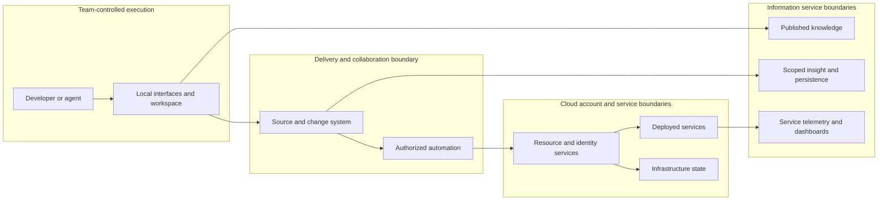

# Design Review / Software Requirements Specification — DX

This draft describes the shared DX offering in terms of user outcomes and
observable guarantees. It is not a prescription for the technologies used to
implement them. The repository is the evidence for the current offering; an
alternative implementation must not claim capabilities or guarantees beyond
that evidence.

The behavioral error identifiers in the child Use Cases are proposed semantic
categories, not claims about the names currently emitted by every interface.
The component and contract entries below are logical groupings, not a mandate
to deploy a single platform or to share one persistence store.

<!-- id: metadata -->

## Header and references

| ID | Value |
| --- | --- |
| `metadata.status` | draft |
| `metadata.title` | DX: developer and agent experience |
| `metadata.canonical-outcome-id` | `DX-DEVEX` |
| `metadata.source-id` | `docs/design-review.md` |
| `metadata.owner` | DX Product Owner |
| `metadata.authors` | DX team (editorial attribution) |
| `metadata.last-updated` | 2026-11-05 |
| `metadata.version` | 0.1.0-draft |

### Related artifacts

| ID | Artifact | Link or reference | Relationship / status |
| --- | --- | --- | --- |
| `references.prd` | PRD | N/A — the stakeholder confirmed there is no applicable PRD. | Direct DR intake; outcome and scope are recorded here. |
| `references.rfc` | RFCs | N/A — the stakeholder confirmed there are no other applicable decision sources. | The identified metrics decision is linked separately below. |
| `references.adr` | Architecture decisions | [Metrics scope decision](../apps/dx-metrics/docs/adr/0001-repository-scopes.md) | Accepted existing decision; scope isolation and current access limitations are propagated to `contracts.item-009` and UC-19. |
| `references.service-blueprint` | Service Blueprint | [DX developer journey](service-blueprint.md) | Draft reconstructed from this DR and its Use Cases; not independent customer research. |
| `references.figma` | Design discovery | N/A — the stakeholder confirmed there are no other applicable design-discovery sources. | User journeys are described by the linked Use Cases. |
| `references.contracts` | Existing interface and data evidence | [CLI capability description](../apps/cli/src/domain/spec.ts), [knowledge service](../apps/mcpserver/README.md), [metrics vocabulary](../apps/dx-metrics/GLOSSARY.md) | Representative existing contracts; a complete portable contract inventory remains open. |
| `references.repository` | Repository | [DX repository](https://github.com/pagopa/dx) | Source of the current offering and implementation evidence. |
| `references.reviews` | Security, privacy and legal reviews | Not supplied; see `open.item-003` | Security and privacy functions assess their respective areas; review evidence and legal-review ownership remain unconfirmed. |
| `references.dpia` | Privacy assessment | Not supplied; see `open.item-003` | The privacy function assesses applicability; no assessment outcome is supplied. |
| `references.launch-review` | Launch readiness review | Not supplied; see `open.item-006` | A separate go/no-go decision is not implied by this document. |
| `references.glossary` | Existing domain vocabulary | [Engineering metrics glossary](../apps/dx-metrics/GLOSSARY.md) | Defines the metrics context; the cross-DX vocabulary is below. |
| `references.operations` | Operational and support references | [Support guide](../apps/website/docs/support.md), [tooling lifecycle](../apps/website/docs/tooling-lifecycle.mdx) | The support and operations baseline is agreed; capability owners, runbooks and escalation evidence remain open. |

<!-- id: expected-outcome -->

## Expected outcome of the initiative

| ID | Item | Description | Source / status |
| --- | --- | --- | --- |
| `outcome.context` | Context and problem | Product software engineering teams and developers are the primary DX customers. They face repeated setup, infrastructure, delivery and operational decisions that slow down service development and increase maintenance effort. Coding agents act on their behalf; other participating roles are secondary users or stakeholders. | [DX motivation](../README.md), [shared offering](../apps/website/docs/index.md), [agent knowledge access](../apps/mcpserver/README.md); customer and role boundaries confirmed in this intake. |
| `outcome.objective` | Expected outcome | Increase team autonomy and productivity, including the ability of coding agents to operate autonomously within applicable guardrails, while maintaining security and reliability. The agreed aggregate outcome indicators are listed below; their operational definitions, baselines and targets remain open. | [DX motivation](../README.md); scope, priorities and indicator categories confirmed in this intake; `open.item-009`. |
| `outcome.scope` | In scope | Shared guidance and knowledge access; workspace and environment setup; infrastructure and access; service integration; quality and delivery; observability; shared asset lifecycle; cost and engineering insights; agentic engineering and delivery guidance, evaluation and support. Document maturity and provider-specific coverage rather than assuming uniform support. | [Shared offering](../apps/website/docs/index.md), [CLI overview](../apps/cli/README.md), [agentic delivery overview](../plugins/padef/README.md), [specialist testing guidance](../plugins/tests/skills/generate-backend-tests/SKILL.md), [metrics overview](../apps/dx-metrics/README.md), [cost analysis](../apps/savemoney/README.md). |
| `outcome.non-goals` | Out of scope | Reproducing every internal maintenance tool, requiring the present implementation stack or exact interface syntax, asserting unsupported features, or turning documentation into a backlog or a new roadmap. | Scope confirmed in this intake. |
| `outcome.constraints` | Relevant constraints | Preserve observable outcomes and evidenced guarantees while allowing alternative implementation choices. An equivalent implementation covers all Must Use Cases and every Should Use Case it offers, within its declared supported environments and integrations. Offer guided defaults; teams may use alternatives that respect applicable guardrails. Agents act within delegated permissions, cannot increase their own privileges or disable controls, respect applicable approval gates, and report outcomes and failures. | Equivalence and agent policy confirmed in this intake; evidence for individual variants and concrete policies remain subject to `open.item-001` and `open.item-002`. |

The agreed core is knowledge and agent support, setup, infrastructure,
security, quality, delivery and observability. Engineering metrics, cost
analysis and specialist workflows are `Should`. A child page records its own
priority; this distinction does not assert that every current capability has
the same maturity.

### Outcome indicators

These are aggregate product outcomes, not service-latency or capacity
objectives. Individual analytics data is used only when necessary and assessed
by the privacy function. Review these indicators quarterly and define any
numerical outcome targets only after a shared baseline exists. This review
cadence does not change the monthly availability measurement in `NFR-02`.
Exact definitions, sources, baselines, targets and observation windows remain
open in `open.item-009`.

| Indicator | Intended signal | Evidence / status |
| --- | --- | --- |
| Time to first useful change | How quickly a team reaches an initial useful outcome. | Agreed indicator; boundaries and data source not yet established. |
| Change lead time | The elapsed time for changes through the delivery process. | [Engineering metrics overview](../apps/dx-metrics/README.md); exact boundaries and baseline remain open. |
| Guided-path adoption | Adoption of shared DX paths by teams or workspaces. | [Engineering metrics overview](../apps/dx-metrics/README.md); coverage and denominator remain open. |
| Service reliability | Whether services and supported operations meet their reliability objectives. | Request-based availability objective in `NFR-02`; measurement evidence remains open. |
| Agent autonomy | The proportion of eligible work completed by agents without intervention beyond that required by policy. | Agreed indicator; eligibility, measurement and baseline remain open. |

<!-- id: solution-design -->

## Solution design

### Technology profile and constraints

The profile deliberately names **building blocks and objectives**, not
providers, programming languages, frameworks or products. Technology selection
and any applicable adoption review belong to a concrete implementation, not to
this technology-neutral specification.

| ID | Topic | Preference / constraint | Technology Radar outcome | Decision / derogation | Owner / status |
| --- | --- | --- | --- | --- | --- |
| `tech.profile.item-001` | Human and agent interfaces | Interactive and machine-consumable access to supported capabilities. | Not assessed for a technology-neutral document. | Interface syntax may differ while outcomes and guarantees are preserved. | DX Product Owner; agreed direction. |
| `tech.profile.item-002` | Knowledge layer | Publish guidance and retrieve information with verifiable source references. | Not assessed. | No specific storage or retrieval technology prescribed; when no relevant verifiable source exists, report that explicitly rather than provide a grounded factual answer. | DX Product Owner; required behavior agreed, current coverage unverified. |
| `tech.profile.item-003` | Workspace and delivery building blocks | Reusable setup, validation, execution, versioning and release capabilities. | Not assessed. | Implementations may choose equivalent automation mechanisms. | DX Product Owner; current capability evidenced. |
| `tech.profile.item-004` | Infrastructure and identity | Reusable infrastructure-as-code abstractions, scoped identities, network boundaries and approval controls. | Not assessed. | Do not assume every adapter supports every scenario. | DX Product Owner; coverage gap in `open.item-001`. |
| `tech.profile.item-005` | Persistence layer | Persist infrastructure state, knowledge or analytical data where the relevant capability requires it. | Not assessed. | These are distinct logical needs, not a required shared database. | DX Product Owner; current uses evidenced. |
| `tech.profile.item-006` | Observability and insight | Collect and present operational signals, engineering measures and cost findings appropriate to each capability. | Not assessed. | Quantitative objectives and retention are open. | DX Product Owner; `open.item-003`, `open.item-004`. |
| `tech.profile.item-007` | Agentic workflows | Provide reusable specialist guidance, structured artifacts and evaluation for engineering and product work. | Not assessed. | Autonomy is bounded by delegated permissions and applicable approvals; agents must not increase their own privileges or disable controls. | DX Product Owner; enforcement evidence remains in `open.item-002`. |

### System context and dependencies

| ID | Component / dependency | Responsibility | Interface or trust boundary | Status |
| --- | --- | --- | --- | --- |
| `solution.context.item-001` | Product and engineering teams | Product SWE teams and developers are primary customers; other product and delivery roles participate as secondary users or stakeholders. Teams consume and contribute guidance, create and operate services, and approve changes where required. | Human access and delegated authority. | Customer and role boundaries confirmed in this intake; [shared offering](../apps/website/docs/index.md). |
| `solution.context.item-002` | Coding agent | Discover and use available knowledge and capabilities on a team's behalf as a delegated actor, not a separate customer. | Delegated permissions and applicable guardrails; no self-escalation or disabling controls; not a substitute for an approval gate. | Agent access is evidenced by the [knowledge service](../apps/mcpserver/README.md); the agreed policy's enforcement coverage remains open. |
| `solution.context.item-003` | Code and collaboration systems | Hold source, changes, shared assets and delivery execution context. | Repository and execution permissions. | Evidenced by [workspace setup](../apps/cli/README.md) and [release automation](../actions/nx-release/README.md). |
| `solution.context.item-004` | Cloud and identity services | Host resources, grant access and supply operational information. | Account, resource, identity and network boundaries. | Evidenced by [access abstractions](../infra/modules/azure_role_assignments/README.md); coverage varies. |
| `solution.context.item-005` | Work-management and support systems | Receive work artifacts, support requests and collaboration. | External system authorization and human decisions. | Evidenced by [agentic delivery](../plugins/padef/README.md) and [support](../apps/website/docs/support.md). |

### Static component view

These are capabilities that may be combined or deployed independently. Arrows
describe collaboration, not a required implementation topology.

| ID | Component | Owns / consumes | Dependencies | Notes |
| --- | --- | --- | --- | --- |
| `solution.components.item-001` | Knowledge and discovery | Published guidance, searchable knowledge and source references. | Documentation sources. | [Knowledge service](../apps/mcpserver/README.md); the agreed no-source behavior is specified in [UC-01](use-cases/uc-01-consult-guidance.md) and is not yet verified. |
| `solution.components.item-002` | Developer and agent interfaces | Interactive and structured access to supported capabilities and their descriptions. | Relevant capability and authorization. | [CLI overview](../apps/cli/README.md), [capability schema](../apps/cli/src/domain/spec.ts). |
| `solution.components.item-003` | Workspace and environment setup | Workspace scaffolding, environment inputs and initialization outcomes. | Code collaboration, cloud account and state services. | [CLI overview](../apps/cli/README.md), [environment generator](../apps/cli/src/adapters/plop/generators/environment/index.ts). |
| `solution.components.item-004` | Infrastructure and access abstractions | Reusable resource definitions, scoped access and provisioning controls. | Cloud and identity services; state and execution. | [Infrastructure orchestration](../packages/nx-terraform-plugin/README.md), [access abstractions](../infra/modules/azure_role_assignments/README.md). |
| `solution.components.item-005` | Change validation and delivery | Change checks, plans, drift detection, deployment and publication. | Code and execution systems, approval policies and target services. | [Delivery overview](../apps/website/docs/pipelines/index.md), [deployment behavior](../actions/deploy/README.md). |
| `solution.components.item-006` | Operational observability | Service signals, dashboards and configurable alerts. | Workload telemetry and service interface descriptions. | [Operational dashboard](../apps/opex-dashboard/README.md). One documented instrumentation mode is experimental; a tracing library is described as beta until its first stable major release. The current version and the maturity of other modes are not established by that statement: [instrumentation maturity](../apps/website/docs/azure/monitoring/azure-tracing.md). |
| `solution.components.item-007` | Cost analysis | Read-only identification and reporting of possible cost risks. | Resource inventory, usage and recommendation sources. | [Cost analysis](../apps/savemoney/README.md). |
| `solution.components.item-008` | Engineering insight | Import, persistence and scoped presentation of engineering and adoption data. | Code and delivery data sources; a persistence layer. | [Metrics portal](../apps/dx-metrics/README.md), [importer](../apps/dx-metrics-import/README.md). |
| `solution.components.item-009` | Agentic workflows | Reusable specialist agent guidance and linked product, design and delivery artifacts. | Knowledge, human decisions and relevant development or work-management systems. | [Agentic delivery overview](../plugins/padef/README.md), [specialist testing guidance](../plugins/tests/skills/generate-backend-tests/SKILL.md). |
| `solution.components.item-010` | Agent capability evaluation | Reproducible evaluation inputs, runs and comparisons. | Agent execution and evaluation evidence. | [Evaluation tool](../apps/harbor-bench/README.md). |
| `solution.components.item-011` | Support and lifecycle guidance | Support channels, contribution paths and shared asset lifecycle guidance. | Product and engineering teams. | [Support guide](../apps/website/docs/support.md), [tooling lifecycle](../apps/website/docs/tooling-lifecycle.mdx). |
| `solution.components.item-012` | State and persistence | The separate state and persistence needs of infrastructure, knowledge and metrics. | The relevant external persistence service. | A logical category; no common store is implied. |
| `solution.components.item-013` | Service connectivity and integration | Private connections and supported service-to-service interaction patterns. | Infrastructure, identities and participating service owners. | [Private connection guide](../apps/website/docs/azure/networking/peps-cross-subscription.md), [integration guide](../apps/website/docs/azure/integrating-services/index.md). Cross-cloud connections require a pre-change overlap check; current enforcement remains unverified. |

### Domain model and glossary

The following vocabulary describes the shared domain. It does not impose a
schema or a common implementation for all components.

| Entity | Description | Key attributes | Relations | States / invariants |
| --- | --- | --- | --- | --- |
| Team | People responsible for a product, service or shared capability. | Responsibility and authorization scope. | Uses a Workspace and may own a Resource or Service. | The owning team sets resource-specific permissions and approval gates within common DX guardrails; ownership is distinct from permission to request access. |
| Coding agent | An automated collaborator acting on a team's behalf. | Delegated authority and available capabilities. | Uses a Workspace, Knowledge artifact and supported interfaces. | The agreed policy prohibits self-escalation and disabling controls, requires applicable approval gates, and requires outcomes and failures to be reported; enforcement evidence remains open. |
| Agent capability | Reusable specialist instructions or behavior available to a Coding agent. | Purpose, applicability, supporting guidance and constraints. | Used by a Coding agent; may be assessed through an Evaluation case and result. | Availability does not grant authority to bypass applicable guardrails. |
| Workspace | A shared development context containing source and configuration. | Identity, owner and conventions. | Contains Changes and may define Environments. | A workspace can exist locally before optional publication. |
| Environment | A named lifecycle context associated with one or more Cloud accounts. | Full name, lifecycle, prefix and associated accounts. | Belongs to a Workspace and uses Infrastructure state. | Initialization and account authorization are distinct; a configured environment remains partial while required account authorization is pending, failed or unverifiable. A qualified name retains its full identity while its final segment identifies the lifecycle. |
| Cloud account | An administrative scope in which Resources are managed. | Identity and location. | Associated with an Environment and accessed through a Principal. | Access and initialization are checked per account. |
| Resource | A managed infrastructure or service capability. | Identity, owner, configuration and access scope. | Belongs to a Cloud account; may support a Service or a Connection. | Desired and observed state can differ. |
| Dataset | Information collected or retained for an identified purpose. | Purpose, data owner, classification and retention. | Owned by a Team; may include operational or engineering observations. | The data-owning team defines classification and retention under applicable policies and obligations; data ownership need not match resource ownership. |
| Infrastructure state | The recorded relationship between declared and managed Resources. | Environment, storage location and non-secret access metadata. | Used to prepare a Plan and apply infrastructure changes. | State and plans can contain sensitive data; restored state must be reconciled with actual resources before further changes. |
| Plan | A proposed change to Resources. | Target context, proposed actions and provenance. | Produced from declarations and Infrastructure state; may be reviewed before application. | A plan is not itself an applied change. |
| Principal and permission | An identity and the authority granted to it over a scope. | Principal, role intent, resource, permitted actions, scope and purpose. | A Principal may be a person, workload or automation; a permission targets a Resource. | Authority is scoped; a request is not an approval; the same role label does not imply identical actions for every resource. |
| Connection | A relationship that permits communication across a network or ownership boundary. | Source, destination and approval state. | Connects Resources or Environments owned by participating Teams. | In the documented cross-owner scenario, the destination owner approves the requested connection. |
| Service and release | A workload and a version made available to consumers. | Service identity, version and deployment target. | A Change produces a release; service signals support observation. | A staged release is distinct from one receiving production traffic. |
| Change and validation result | A proposed modification and the outcome of checks applied to it. | Scope, revision, checks and result. | A Change can produce a Plan, release or shared asset version. | A failed required check is not a successful check. |
| Knowledge artifact | Guidance or a machine-discoverable description of a capability. | Content, source and version where available. | Consulted by Teams and Coding agents. | A source reference identifies evidence; it does not prove an answer is complete. |
| Cost finding | A reported resource or recommendation worth reviewing. | Resource, observed signal, category and estimate where available. | Derived from resource and usage data. | Cost at risk is not guaranteed savings; analysis is read-only. |
| Engineering observation and scope | Imported engineering data and the subset visible to a reader. | Source, observation time, available range and visibility scope. | Observations feed metrics; a scope selects repositories from the imported portfolio. | A scope does not itself grant source-system permission. Global data without a repository dimension is limited to full scopes by default; exceptions require explicit data-owner classification and applicable privacy assessment. The current implementation uses shared credentials rather than personal identity; alternatives may use other access mechanisms. |
| Product artifact and Use Case | A documented product or solution decision and a separately maintained behavior. | Source, owner, status and links. | Product artifacts link to Use Cases and may be projected into work items. | A Use Case is `draft` or `ready`; a human confirms promotion. |
| Evaluation case and result | An input for assessing an agent capability and the outcome of a run. | Scenario, version, criteria and measured result. | Cases can be run against multiple capability versions and compared. | A comparison reports differences; it does not itself approve a capability. |

| Term | Definition | Not to confuse with |
| --- | --- | --- |
| Golden path | A guided default that helps teams achieve a recurring outcome with common safeguards. | A claim that every alternative is prohibited. |
| Guardrail | An applicable constraint, permission or approval that bounds an action. | A blanket claim that all existing flows enforce the same policy. |
| Deployment environment | A lifecycle and administrative context for a service or infrastructure. | A developer's local execution environment. |
| Critical DX service | A DX service whose unavailability blocks development, release or safe operation of services without a practical alternative. | Every shared capability or every downstream workload. |
| Repository scope | The subset of imported repositories visible to a metrics reader. An access mechanism may bind the scope to an identity. | The identity itself, a tenant or source-system authorization. |
| Cost at risk | An estimated cost associated with a finding worth investigating. | A confirmed saving. |
| Declared support scope | The environments and integrations for which an implementation claims to satisfy a capability. | A requirement to support every existing provider or integration. |
| Maturity | The evidenced lifecycle or support state of a capability or its particular variant. | A uniform status for the whole DX offering. |

For this review, `documented` means that relevant source evidence exists, not
that a capability is necessarily production-ready; `experimental` applies only
where an authoritative source says so; `unverified` means the evidence is
insufficient and does not by itself mean unsupported. The remaining
variant-by-variant inventory is tracked in `open.item-001`.

### Deployment and architecture view

The view is intentionally technology-neutral at the user's request. It shows
the actual **classes of placement and trust boundary** represented by the
sources, not a single deployment or a claim that all components share a
runtime.

| ID | Environment / boundary | Runtime placement | Scaling / resilience | Status |
| --- | --- | --- | --- | --- |
| `solution.deployment.item-001` | Team-controlled execution | Local or delegated interfaces act against a workspace. | Depends on the selected capability and environment. | Evidenced by [CLI usage](../apps/cli/README.md); portable topology. |
| `solution.deployment.item-002` | Delivery and cloud accounts | Authorized automation interacts with resource, identity and state services within configured boundaries. | Approval and failure handling vary by operation. | Evidenced by [environment setup](../infra/modules/github_environment_bootstrap/README.md) and [deployment](../actions/deploy/README.md). |
| `solution.deployment.item-003` | Information services | Published knowledge and scoped engineering insight use their own service and persistence needs. | Targets and recovery objectives are not established. | Evidenced by [knowledge access](../apps/mcpserver/README.md) and [metrics](../apps/dx-metrics/README.md); `open.item-004`. |

### Assumptions, constraints, and trade-offs

| ID | Type | Statement or decision | Impact | Owner / decision date | Evidence |
| --- | --- | --- | --- | --- | --- |
| `solution.decision.item-001` | Constraint | Specify building blocks rather than concrete technologies. | Enables alternative implementations; adapter-specific details stay in source evidence. | Requesting stakeholder; 2026-11-04. DX Product Owner to review. | Confirmed scope in this intake. |
| `solution.decision.item-002` | Decision | Preserve observed results and guarantees, not exact interface syntax. | A replacement needs behavioral conformance evidence and must not silently broaden support. | Requesting stakeholder; 2026-11-04. DX Product Owner to review. | Confirmed scope; `open.item-001`, `open.item-005`. |
| `solution.decision.item-003` | Decision | Guided defaults coexist with alternatives that satisfy applicable guardrails. | Reuse is encouraged without making one implementation mandatory. | Requesting stakeholder; 2026-11-04. DX Product Owner to review. | Confirmed direction; precise guardrails in `open.item-002`. |
| `solution.decision.item-004` | Decision | Agents act autonomously within delegated authority, must not increase their own privileges or disable controls, respect applicable approval gates, and report outcomes and failures. No additional human approval is required solely because an agent performs an otherwise authorized action. | Autonomous operation does not bypass a protected change or ownership boundary; enforcement must be verified separately. | Requesting stakeholder; 2026-11-04. DX Product Owner to review. | Policy confirmed in this intake; [protected delivery environments](../infra/modules/github_environment_bootstrap/README.md); enforcement gap in `open.item-002`. |
| `solution.decision.item-005` | Constraint | Describe existing shared capabilities and mark evidence gaps or experimental status; do not invent a target-state feature. | Coverage and maturity are assessed per capability. | Requesting stakeholder; 2026-11-04. DX Product Owner to review. | Confirmed scope; `open.item-001`. |
| `solution.decision.item-006` | Decision | Equivalence requires all Must Use Cases and every offered Should Use Case within the implementation's declared supported environments and integrations. Maturity is evidenced per capability or variant. | Alternative implementations need not support every existing provider, but cannot claim equivalence for an unverified variant. | Requesting stakeholder; 2026-11-04. DX Product Owner to review. | Confirmed equivalence criterion; variant evidence remains in `open.item-001`. |
| `solution.decision.item-007` | Decision | DX defines common guardrails and coordinates their adoption; the owning team sets permissions and approval gates for each resource within those guardrails. | Resource-specific decisions remain with the relevant owner; concrete policies and enforcement need evidence. | Requesting stakeholder; 2026-11-04. DX Product Owner to review. | Confirmed responsibility model; action-specific coverage remains in `open.item-002`. |
| `solution.decision.item-008` | Decision | Minimize collected data, restrict access, protect confidential data in transit and at rest, exclude secret values from outputs and logs, and assess security and privacy before production. | Establishes a common baseline; retention periods, specialist ownership and evidence of implementation or assessment remain open. | Requesting stakeholder; 2026-11-04. DX Product Owner to review. | Confirmed security and privacy baseline; `open.item-003`. |
| `solution.decision.item-009` | Decision | The team owning each dataset defines its classification and retention under applicable policies and obligations; security and privacy functions assess their respective areas, and the DX Product Owner coordinates evidence. | Data ownership is distinct from resource ownership; actual team assignments, retention values and completed assessments still need evidence. | Requesting stakeholder; 2026-11-04. DX Product Owner to review. | Confirmed responsibility model; `open.item-003`. |
| `solution.decision.item-010` | Decision | Audit sensitive operations with actor, resource, time, outcome and applicable approvals, without secret values. Keep product analytics separate and aggregated by default; individual data is used only when necessary and assessed by the privacy function. | Preserves accountability while limiting analytics data; the sensitive-operation inventory, event coverage and retention still need evidence. | Requesting stakeholder; 2026-11-04. DX Product Owner to review. | Confirmed audit and analytics policy; `open.item-003`. |
| `solution.decision.item-011` | Decision | Continuously accessible DX services have a monthly availability objective of at least 99.9% contractually correct responses to valid, authorized requests. Expected outcomes such as no source or pending approval count as correct when communicated correctly; internal errors, timeouts and dependency failures count as failures. Correctly rejected invalid or unauthorized requests are excluded. On-demand interfaces are measured by execution success rather than time-based uptime. | The request-based objective does not imply a fixed number of downtime minutes; service-specific edge cases, measurement and baselines remain open. | Requesting stakeholder; 2026-11-04. DX Product Owner to review. | Confirmed target and measurement principle, not a claim of observed performance; `open.item-004`. |
| `solution.decision.item-012` | Decision | Following a severe incident, a DX service designated critical has a recovery time objective of at most 4 hours. A service is critical when its unavailability blocks development, release or safe operation without a practical alternative; the DX Product Owner and technical owner identify the affected services. Verify recovery through exercises. | This exceptional recovery limit is separate from the monthly availability objective and can consume its error budget; specific service assignments, recovery procedures and evidence remain open. | Requesting stakeholder; 2026-11-04. DX Product Owner to review. | Confirmed target and criticality criterion, not a claim of demonstrated recovery; `open.item-004`. |
| `solution.decision.item-013` | Decision | Critical, non-reconstructible data has a recovery point objective of at most 1 hour. Restored infrastructure state must be reconciled with actual resources before further changes. | A recovery point can still be stale; dataset classification, restoration procedures and evidence remain open. | Requesting stakeholder; 2026-11-04. DX Product Owner to review. | Confirmed target and recovery guardrail, not a claim of demonstrated recovery; `open.item-004`, `open.item-007`. |
| `solution.decision.item-014` | Decision | This DR does not define performance objectives. Existing performance measurements and configurable alerts may still be used operationally. | No universal latency or execution-duration target is imposed. | Requesting stakeholder; 2026-11-04. DX Product Owner to review. | Confirmed scope decision. |
| `solution.decision.item-015` | Decision | This DR does not document numerical capacity targets, load assumptions or capacity limits. | Capacity is outside the document's specification scope. | Requesting stakeholder; 2026-11-04. DX Product Owner to review. | Confirmed scope decision. |
| `solution.decision.item-016` | Decision | Each offered capability has a documented, versioned behavioral contract covering inputs, outcomes and semantic error categories. Agent-accessible operations provide machine-readable results. Verify conformance against Use Cases and declared variants without prescribing a protocol or format. | Enables portable implementations and agent consumption; existing contract and implementation coverage must still be verified. | Requesting stakeholder; 2026-11-04. DX Product Owner to review. | Confirmed contract policy; `open.item-005`. |
| `solution.decision.item-017` | Decision | Maintain backward compatibility within supported major versions. An incompatible contract change requires a new major version and a documented migration path. Each capability declares its supported major versions and communicates end of support; no uniform minimum support period is imposed. | Protects consumers while making breaking transitions explicit; actual support periods and per-contract evidence remain open. | Requesting stakeholder; 2026-11-04. DX Product Owner to review. | Confirmed compatibility and support-lifecycle policy; `open.item-005`. |
| `solution.decision.item-018` | Decision | Every shared capability has a documented technical owner and support channel. Operated DX services also require operational procedures, alerts and escalation; no numerical support response-time SLA is set. | Clarifies ownership and support without inventing a response-time commitment; assignments and operational evidence remain open. | Requesting stakeholder; 2026-11-04. DX Product Owner to review. | Confirmed support and operations baseline; `open.item-006`. |
| `solution.decision.item-019` | Decision | Human-facing web interfaces and content target WCAG 2.2 level AA, including verification with keyboard navigation and assistive technologies. This DR does not define accessibility requirements for non-web interfaces. | Establishes a web accessibility target, not a claim that existing interfaces comply or that non-web interfaces are exempt from applicable obligations. | Requesting stakeholder; 2026-11-04. DX Product Owner to review. | Confirmed scope and target; [WCAG 2.2](https://www.w3.org/TR/WCAG22/); `open.item-006`. |
| `solution.decision.item-020` | Decision | Classify operation outcomes as `success` only when all required steps succeed, `partial` when some required steps succeed and others remain incomplete, and `failed` when no partial result is confirmed. Report known and uncertain step outcomes or effects without assuming automatic rollback. | Makes incomplete work visible to people and agents; required-step definitions and current implementation coverage remain open. | Requesting stakeholder; 2026-11-04. DX Product Owner to review. | Confirmed outcome policy; `open.item-007`. |
| `solution.decision.item-021` | Decision | Automatic retries are bounded per execution and apply only to transient errors when the operation can be repeated safely. A later scheduled execution may resume eligible incomplete work when safe; persistent errors remain explicit. Verify or reconcile uncertain effects before retrying; stop automatic retries and report input, permission and approval failures. | Avoids unsafe duplicate changes while allowing scheduled recovery; per-operation limits and safety evidence remain open. | Requesting stakeholder; 2026-11-04. DX Product Owner to review. | Confirmed retry and scheduled-resumption policy; `open.item-007`. |
| `solution.decision.item-022` | Decision | Automatic rollback is allowed only when authorized, safe and verified. Otherwise stop, report known or uncertain effects and provide reconciliation guidance; do not promise universal rollback. | Supports safe recovery without implying atomicity; per-operation rollback safety and current enforcement remain open. | Requesting stakeholder; 2026-11-04. DX Product Owner to review. | Confirmed rollback policy; `open.item-007`. |
| `solution.decision.item-023` | Decision | Track aggregate outcome indicators for first useful change, change lead time, guided-path adoption, service reliability and agent autonomy. | Provides a balanced product view without setting service-latency or capacity objectives; definitions and targets remain open. | Requesting stakeholder; 2026-11-04. DX Product Owner to review. | Confirmed indicator categories; `open.item-009`. |
| `solution.decision.item-024` | Decision | Review outcome indicators quarterly and define any numerical outcome targets only after establishing a shared baseline. | Avoids invented improvement targets; this product-review cadence is separate from the monthly availability measurement. | Requesting stakeholder; 2026-11-04. DX Product Owner to review. | Confirmed cadence and baseline policy; `open.item-009`. |
| `solution.decision.item-025` | Decision | Product SWE teams and developers are DX's primary customers; coding agents are delegated actors, and other participating people are secondary users or stakeholders. The service blueprint uses shared, non-mandatory phases and role-specific journeys. | Clarifies customer and service boundaries without assuming that each role is a separate team or that all phases occur. | Requesting stakeholder; 2026-11-05. DX Product Owner to review. | Confirmed blueprint scope; [developer journey](service-blueprint.md). |

<!-- id: non-functional -->

## Non-functional requirements and compliance

Targets apply only where confirmed. The DX Product Owner owns resolution of
cross-cutting gaps and must identify specialist owners where needed.

| ID | Area | Requirement / target | Verification evidence | Owner | Status |
| --- | --- | --- | --- | --- | --- |
| `NFR-01` | Performance | N/A — the stakeholder confirmed that this DR will not define performance objectives. Existing measurements and operational alerts remain available where supported. | `solution.decision.item-014`; [operational dashboard](../apps/opex-dashboard/README.md). | DX Product Owner | Not applicable for this DR. |
| `NFR-02` | Availability / SLO | For each continuously accessible DX service, at least 99.9% of valid, authorized requests receive a contractually correct response over a monthly measurement period. Correctly communicated expected outcomes such as no source or pending approval count as success; internal errors, timeouts and dependency failures count as failures. Correctly rejected invalid or unauthorized requests are excluded. On-demand interfaces are assessed by execution success, with their targets still to be set. | Define service-specific eligibility edge cases, period boundaries, measurement and baselines: `open.item-004`. | DX Product Owner; service-specific owners to be identified. | Target and measurement principle agreed; operational evidence pending. |
| `NFR-03` | Scalability | N/A — the stakeholder confirmed that capacity targets, load assumptions and limits are outside this DR's scope. | `solution.decision.item-015`. | DX Product Owner | Not applicable for this DR. |
| `NFR-04` | Security | Respect scoped permissions and configured approvals; prevent agent self-escalation and disabling of controls; exclude secret values from outputs and logs; audit sensitive operations. The documented saved-plan flow protects stored plans and filters relevant output, while an interactive path inherits output without filtering; compliance across all paths is unverified. | [Access abstractions](../infra/modules/azure_role_assignments/README.md), [protected plan transfer](../actions/terraform-plan-upload/README.md), [plan execution](../packages/nx-terraform-plugin/README.md); audit: `contracts.item-014`; enforcement: `open.item-002`; security review: `open.item-003`. | DX for common guardrails; resource-owning teams for their scope; DX Product Owner coordinates evidence. | Baseline agreed; enforcement and review required. |
| `NFR-05` | Legal / privacy | Minimize collected data, restrict access and protect confidential data in transit and at rest. Product analytics are aggregated by default; individual data requires necessity and privacy assessment. Global metrics without a repository dimension are visible to full scopes by default; limited scopes require explicit shareable classification and applicable privacy assessment. Assess security and privacy before production; identify applicable legal obligations and retention periods. | Assessment and decisions: `open.item-003`; [UC-19 decision](use-cases/uc-19-explore-engineering-metrics.md#open-questions-and-propagation). | Data-owning teams for classification and retention; security and privacy functions for their assessments; DX Product Owner coordinates evidence. | Baseline and role model agreed; assessment and evidence remain a production launch blocker. |
| `NFR-06` | Continuity / recovery | DX services designated critical have an RTO of at most 4 hours after a severe incident; the DX Product Owner and technical owner classify criticality by impact and lack of a practical alternative. Critical, non-reconstructible data has an RPO of at most 1 hour. Reconcile restored infrastructure state before further changes. Automatic retries are bounded per execution and only for transient failures when safe; later scheduled executions may safely resume eligible incomplete work. Automatic rollback requires authorization, safety and verification; otherwise report effects and reconciliation guidance. | Recovery exercises, classification and remaining procedures: `open.item-004`, `open.item-007`. | DX Product Owner and relevant technical owners; specific service and data owners to be identified. | RTO/RPO, criticality criterion, retry and rollback policies agreed; recovery evidence and remaining objectives open. |
| `NFR-07` | Monitoring / observability | Where supported, expose service signals and configurable operational dashboards and alerts. Operated DX services require procedures, alerting and escalation. | [Operational dashboard](../apps/opex-dashboard/README.md); `solution.decision.item-018`; `open.item-006`. | Technical owners of operated DX services; DX Product Owner coordinates evidence. | Baseline agreed; ownership and coverage evidence remain open. |
| `NFR-08` | Accessibility / UX | Human-facing web interfaces and content must meet WCAG 2.2 level AA, verified with keyboard navigation and assistive technologies. N/A for non-web interfaces within this DR — the stakeholder chose not to define requirements for them; applicable obligations are not waived. | [WCAG 2.2](https://www.w3.org/TR/WCAG22/); assessment: `open.item-006`. | DX Product Owner; accessibility assessment owner to be identified. | Web target and non-web scope agreed; existing conformance and assessment evidence unverified. |
| `NFR-09` | Agent operability | Agent-accessible operations provide machine-readable `success`, `partial` or `failed` outcomes with semantic failure categories and known or uncertain effects. Unsupported or interactive-only paths must not be presented as autonomous. | [Capability schema](../apps/cli/src/domain/spec.ts), [CLI overview](../apps/cli/README.md); `open.item-001`, `open.item-002`, `open.item-005`, `open.item-007`. | DX Product Owner | Requirement agreed; current implementation coverage remains partial or unverified. |
| `NFR-10` | Compatibility | Contracts remain backward-compatible within supported major versions. Incompatible changes require a new major version and a documented migration path. Each capability declares supported major versions and communicates end of support; there is no uniform minimum support duration. | `solution.decision.item-017`; [release process](../actions/nx-release/README.md), [tooling lifecycle](../apps/website/docs/tooling-lifecycle.mdx). | DX Product Owner | Policy agreed; actual support periods and per-contract evidence remain open. |
| `NFR-11` | Support / operations | Every shared capability has a documented technical owner and primary support channel; if that channel is unavailable, report the failure rather than automatically using a fallback. Operated DX services also have procedures, alerts and escalation. No numerical support response-time SLA is specified. | `solution.decision.item-018`, [UC-23 decision](use-cases/uc-23-obtain-support-contribute.md#open-questions-and-propagation), [support guide](../apps/website/docs/support.md); `open.item-006`. | Technical owners of the relevant capabilities; DX Product Owner coordinates evidence. | Baseline agreed; assignments and operational evidence remain open. |

<!-- id: use-case-index -->

## Dynamic component view and Use Case index

| ID | Title | Child page |
| --- | --- | --- |
| `UC-01` | Consult and retrieve DX guidance | [Use Case](use-cases/uc-01-consult-guidance.md) |
| `UC-02` | Discover and invoke DX capabilities | [Use Case](use-cases/uc-02-discover-invoke-capabilities.md) |
| `UC-03` | Bootstrap a development workspace | [Use Case](use-cases/uc-03-bootstrap-workspace.md) |
| `UC-04` | Add a deployment environment | [Use Case](use-cases/uc-04-add-deployment-environment.md) |
| `UC-05` | Start a reproducible development environment | [Use Case](use-cases/uc-05-start-development-environment.md) |
| `UC-06` | Assess workspace conformance | [Use Case](use-cases/uc-06-assess-workspace-conformance.md) |
| `UC-07` | Apply a supported migration | [Use Case](use-cases/uc-07-apply-migration.md) |
| `UC-08` | Plan and provision infrastructure | [Use Case](use-cases/uc-08-provision-infrastructure.md) |
| `UC-09` | Grant scoped access to resources | [Use Case](use-cases/uc-09-grant-scoped-access.md) |
| `UC-10` | Establish private connectivity across ownership boundaries | [Use Case](use-cases/uc-10-connect-across-ownership-boundaries.md) |
| `UC-11` | Connect environments across cloud boundaries | [Use Case](use-cases/uc-11-connect-cloud-boundaries.md) |
| `UC-12` | Integrate services securely | [Use Case](use-cases/uc-12-integrate-services.md) |
| `UC-13` | Validate and integrate a change | [Use Case](use-cases/uc-13-validate-change.md) |
| `UC-14` | Detect infrastructure drift | [Use Case](use-cases/uc-14-detect-infrastructure-drift.md) |
| `UC-15` | Release a service safely | [Use Case](use-cases/uc-15-release-service.md) |
| `UC-16` | Version and publish reusable assets | [Use Case](use-cases/uc-16-publish-assets.md) |
| `UC-17` | Observe a service and generate operational dashboards | [Use Case](use-cases/uc-17-observe-service.md) |
| `UC-18` | Identify resource cost risks | [Use Case](use-cases/uc-18-identify-cost-risks.md) |
| `UC-19` | Explore engineering and adoption metrics | [Use Case](use-cases/uc-19-explore-engineering-metrics.md) |
| `UC-20` | Guide a product initiative with agentic workflows | [Use Case](use-cases/uc-20-guide-product-initiative.md) |
| `UC-21` | Compare agent capability quality | [Use Case](use-cases/uc-21-compare-agent-capability.md) |
| `UC-22` | Assess a technology against adoption guidance | [Use Case](use-cases/uc-22-assess-adoption-guidance.md) |
| `UC-23` | Obtain support and contribute improvements | [Use Case](use-cases/uc-23-obtain-support-contribute.md) |
| `UC-24` | Apply specialist agent guidance to engineering work | [Use Case](use-cases/uc-24-apply-specialist-agent-guidance.md) |

<!-- id: data-contracts -->

## Data and technical contracts

Each offered capability requires a documented, versioned behavioral contract
covering inputs, outcomes and semantic error categories. Agent-accessible
operations require machine-readable results. Conformance is checked against
the relevant Use Cases and declared variants without requiring a particular
protocol or format. Supported major versions remain backward-compatible;
incompatible changes require a new major version and a documented migration
path. Each capability declares supported major versions and communicates their
end of support without a uniform minimum duration. Operation outcomes
distinguish `success`, `partial` and `failed` and
include known or uncertain step outcomes and effects; they do not imply
automatic rollback. Automatic retries are bounded per execution and limited to
transient failures where repetition is safe; a later scheduled execution may
resume eligible incomplete work. Uncertain effects require verification or
reconciliation before retrying. Automatic rollback requires authorization,
safety and verification; otherwise the operation stops and reports effects and
reconciliation guidance. Support periods and concrete compatibility evidence
remain open.

The entries below identify behavioral surfaces and link existing evidence.
They do not assert that a complete implementation-independent contract or
machine-readable result already exists for every capability; see
`open.item-005`.

| ID | Contract / entity | Type | Owner | Version / compatibility | Link | Status |
| --- | --- | --- | --- | --- | --- | --- |
| `contracts.item-001` | Capability description and execution result | Discovery / integration | DX Product Owner | Existing description is versioned; equivalent interface syntax may differ. Agent-accessible operations require machine-readable results and semantic failure categories. | [Capability schema](../apps/cli/src/domain/spec.ts), [validation command](../apps/cli/src/adapters/commander/commands/doctor.ts) | Existing evidence covers supported commands; broader conformance remains open. |
| `contracts.item-002` | Knowledge query, answer and source references | Integration | DX Product Owner | If no relevant verifiable source is available, return an explicit no-source outcome without a factual answer; distinguish this from a service failure. | [Knowledge service](../apps/mcpserver/README.md), [UC-01 decision](use-cases/uc-01-consult-guidance.md#open-questions-and-propagation) | Behavior agreed; current implementation and broader portable contract remain unverified. |
| `contracts.item-003` | Workspace and environment inputs and result | Configuration / data | DX Product Owner | Workspace publication is optional, without removing existing external prerequisites. Preserve environment identity and non-secret state metadata; expose per-account authorization outcomes and report partial until required authorizations are approved or unnecessary. | [Workspace initialization](use-cases/uc-03-bootstrap-workspace.md), [environment authorization decision](use-cases/uc-04-add-deployment-environment.md#open-questions-and-propagation), [environment output](../apps/cli/src/adapters/commander/commands/add.ts) | Publication and authorization policies agreed; complete per-account outcome coverage is unverified. |
| `contracts.item-004` | Infrastructure declaration, plan, state and application | Data / integration | DX Product Owner | Locked dependency and saved-plan behavior are flow-specific. | [Infrastructure orchestration](../packages/nx-terraform-plugin/README.md) | Documented for supported flows. |
| `contracts.item-005` | Identity, scope and connection approval | Integration / access policy | DX and resource-owning teams | Specify permitted actions and scope for each resource type and role intent; equivalent implementations preserve those actions, not provider-specific role names. | [Access abstractions](../infra/modules/azure_role_assignments/README.md), [private connection guide](../apps/website/docs/azure/networking/peps-cross-subscription.md), [UC-09 decision](use-cases/uc-09-grant-scoped-access.md#open-questions-and-propagation) | Responsibility and mapping principles agreed; per-resource contracts and enforcement evidence remain open. |
| `contracts.item-006` | Change checks, deployment and release result | Integration / operational | DX Product Owner | Staging does not change production traffic. Configured incremental rollout validates each step and restores the previous path on failure only when rollback is authorized, safe and verified; target-specific capabilities and limits remain explicit. An incomplete drift inspection must produce a non-success outcome and alert the responsible owner; alert-delivery failure is explicit. | [Delivery overview](../apps/website/docs/pipelines/index.md), [deployment](../actions/deploy/README.md), [release](../actions/nx-release/README.md), [UC-14 decision](use-cases/uc-14-detect-infrastructure-drift.md#open-questions-and-propagation), [UC-15 decision](use-cases/uc-15-release-service.md#open-questions-and-propagation) | Documented scenarios; target coverage, rollback safety and incomplete-inspection behavior remain unverified. |
| `contracts.item-007` | Service definition, signals, dashboard and alerts | Data / integration | DX Product Owner | Reject publication when required inputs are invalid; present missing signals as unknown or unavailable, never as healthy or zero. Inputs and supported output targets remain capability-specific. | [Operational dashboard](../apps/opex-dashboard/README.md), [UC-17 decision](use-cases/uc-17-observe-service.md#open-questions-and-propagation) | Failure behavior agreed; current implementation remains unverified. |
| `contracts.item-008` | Resource findings and cost estimates | Data / report | DX Product Owner | Finding and estimate semantics are distinct. | [Cost analysis](../apps/savemoney/README.md) | Documented; coverage varies. |
| `contracts.item-009` | Engineering observations, ranges and visibility scope | Data / access | DX Product Owner | Preserve freshness and authorized repository-scope isolation, including against cross-scope cache leakage, without prescribing the access mechanism. Global data without a repository dimension is visible to full scopes by default and to limited scopes only when explicitly classified as shareable and privacy-assessed where applicable. The current shared credential is not a personal identity and has no individual-link revocation. | [Metrics glossary](../apps/dx-metrics/GLOSSARY.md), [metrics scope decision](../apps/dx-metrics/docs/adr/0001-repository-scopes.md), [UC-19 decision](use-cases/uc-19-explore-engineering-metrics.md#open-questions-and-propagation) | Scope and global-data policy agreed; data classification and current conformance remain unverified. |
| `contracts.item-010` | Specialist agent guidance and linked product, design, Use Case and work artifacts | Document / integration | DX Product Owner | Preserve applicable instructions, artifact IDs, lifecycle gates and links. | [Agentic delivery overview](../plugins/padef/README.md), [Use Case workflow](../plugins/padef/skills/uc-engraver/SKILL.md), [specialist testing guidance](../plugins/tests/skills/generate-backend-tests/SKILL.md) | Documented workflows; applicability varies by capability. |
| `contracts.item-011` | Evaluation case, run and comparison | Data / report | DX Product Owner | Compare runs only when cases, evaluation criteria and execution conditions are equivalent except for the declared variable under examination; report mismatches without presenting deltas as valid. | [Evaluation tool](../apps/harbor-bench/README.md), [UC-21 decision](use-cases/uc-21-compare-agent-capability.md#open-questions-and-propagation) | Comparability policy agreed; current implementation remains unverified. |
| `contracts.item-012` | Guidance lifecycle, adoption advice and support | Documentation / human interaction | DX Product Owner | Declare supported major versions and communicate end of support per capability. If adoption guidance is unavailable, report the gap; new choices require restored guidance or authorized confirmation, while documented existing choices may continue with the gap explicit. Support uses the designated primary channel; report its unavailability without automatically routing to a fallback. | [Adoption guidance](../plugins/standards/skills/technology-radar/SKILL.md), [UC-22 decision](use-cases/uc-22-assess-adoption-guidance.md#open-questions-and-propagation), [UC-23 decision](use-cases/uc-23-obtain-support-contribute.md#open-questions-and-propagation) | Lifecycle, unavailable-guidance and support-channel policies agreed; implementation and ownership evidence remain open. |
| `contracts.item-013` | Service interaction and communication | Integration | DX Product Owner | This DR does not prescribe delivery, ordering or recovery guarantees for service-integration patterns. Documented retry and failure-handling options remain descriptive; common retry safety still applies when used. | [Service integration guide](../apps/website/docs/azure/integrating-services/index.md), [UC-12 decision](use-cases/uc-12-integrate-services.md#open-questions-and-propagation) | Scope decision agreed; other portable contract evidence remains open. |
| `contracts.item-014` | Sensitive-operation audit record | Audit / data | DX and data-owning teams | Record actor, resource, time, outcome and applicable approvals without secret values; event names and format are not yet established. | `solution.decision.item-010` | Policy agreed; event inventory, retention and enforcement evidence remain open in `open.item-003`. |
| `contracts.item-015` | Cross-cloud connection preflight | Integration / validation | DX Product Owner and resource-owning teams | Reject overlapping network ranges before making any change related to the connection. | [UC-11 decision](use-cases/uc-11-connect-cloud-boundaries.md#open-questions-and-propagation) | Requirement agreed; current implementation and conformance evidence remain unverified. |

### Data lifecycle and audit

`contracts.data-lifecycle` — The agreed baseline minimizes data, restricts
access, protects confidential data in transit and at rest, and excludes secret
values from outputs and logs. Infrastructure state and saved plans can contain
sensitive data; one documented transfer flow encrypts saved plans, and the
automated saved-plan output is filtered, but compliance of every output path is
not established. Engineering observations are imported incrementally, with a
cursor advancing only after the relevant import window completes; some adoption
data is a current snapshot rather than history. Metrics visibility is scoped
separately from source-system permissions. Cost analysis is read-only.
Each data-owning team defines classification and retention under applicable
policies and obligations; security and privacy functions assess their respective
areas, coordinated by the DX Product Owner. Audit records for sensitive
operations are distinct from product analytics; the latter are aggregated by
default, with individual data used only when necessary and assessed by privacy.
Actual team assignments, retention values, sensitive-operation and audit-event
coverage, assessment evidence and deletion responsibilities across capabilities
remain open: `open.item-003`.

<!-- id: execution-readiness -->

## Execution, validation, rollout, and readiness

### Delivery strategy

| ID | Topic | Strategy | Evidence / owner | Status |
| --- | --- | --- | --- | --- |
| `execution.rollout` | Rollout / migration | Existing delivery supports staged and, when configured, incremental traffic movement; shared asset releases use versioned publication. Incompatible contract changes require a new major version and a documented migration path for affected consumers. | [Deployment behavior](../actions/deploy/README.md), [release process](../actions/nx-release/README.md), `solution.decision.item-017`; DX Product Owner. | Policy agreed; cross-offering migration evidence open. |
| `execution.rollback` | Rollback / recovery | Automatic rollback is allowed only when authorized, safe and verified; otherwise stop and report effects and reconciliation guidance. A failed configured incremental rollout is documented to restore the previous traffic path, but its compliance with this policy needs evidence. Critical DX services have a 4-hour RTO target; critical non-reconstructible data has a 1-hour RPO target. Reconcile restored infrastructure state before further changes. | [Deployment behavior](../actions/deploy/README.md); DX Product Owner; `open.item-004`, `open.item-007`. | Rollback policy agreed; safety evidence and recovery targets not yet verified. |
| `execution.dependencies` | Delivery dependencies | Authorization, source and execution systems, cloud resources, identity, state and any required human approvals must be available for the relevant capability. | [Environment setup](../infra/modules/github_environment_bootstrap/README.md); DX Product Owner. | Capability-specific. |

### Validation strategy

| ID | Validation area | Scenario / evidence | Owner | Status |
| --- | --- | --- | --- | --- |
| `validation.e2e` | End-to-end | Exercise every Must Use Case and each offered Should Use Case across the applicable declared support scope; record evidence for each claimed variant rather than assuming parity across environments or integrations. | DX Product Owner | Equivalence criterion agreed; coverage plan and evidence remain open in `open.item-001`. |
| `validation.contracts` | Contract / integration | Verify inputs, `success` / `partial` / `failed` outcomes, known and uncertain effects, safe bounded retries, and semantic errors against each offered capability's versioned behavioral contract, relevant child acceptance checks and declared variants; check machine-readable results for agent-accessible operations. | DX Product Owner | Portable contract and outcome coverage evidence open; `open.item-005`, `open.item-007`. |
| `validation.nfr` | NFR / compliance | Assess security, privacy, accessibility and recovery against approved requirements; verify web accessibility with keyboard navigation and assistive technologies; measure the monthly ratio of contractually correct responses to valid, authorized requests for continuously accessible services, including expected negative outcomes. No performance objective is defined by this DR. | DX Product Owner | Eligibility edge cases, measurement and evidence open; `open.item-003`, `open.item-004`, `open.item-006`. |
| `validation.operations` | Operational readiness | Verify capability owners and support channels, operated-service procedures, alerting and escalation, applicable approval paths and recovery before launch, including exercises against the critical-service RTO, critical-data RPO and restored-state reconciliation. | DX Product Owner | Open; `open.item-004`, `open.item-006`, `open.item-007`. |

### Readiness gates

**Review gate:** this document remains `draft`; a human reviewer must confirm
any transition to `review` or `baseline`. Gaps do not prevent drafting.

| ID | Criterion | Evidence / status |
| --- | --- | --- |
| `ready.outcome-id` | Stable outcome identity | `DX-DEVEX` is recorded above. |
| `ready.prd` | Outcome and scope | Direct intake is documented in Expected outcome; the stakeholder confirmed there is no applicable PRD. |
| `ready.solution` | Required sections and technology profile | Present with explicit gaps; the requested technology-neutral profile intentionally does not select implementation technologies. |
| `ready.domain` | Domain model and glossary | Descriptive model above; review of boundaries and completeness remains open. |
| `ready.conditional` | Relevant conditional blocks | Components, deployment and contracts are represented; unresolved details are linked to open items. |
| `ready.use-cases` | Catalog and child minimum core | See each linked child; no child is promoted without human confirmation. |
| `ready.discovery-links` | Design discovery and blueprint | A [draft Service Blueprint](service-blueprint.md) is linked and derived from this DR and its Use Cases; it is not independent customer research. Journey validation remains open in `open.item-010`. No other applicable design-discovery source was supplied. |
| `ready.contracts` | Interface and data contracts | Evidence linked above; portability and completeness remain open in `open.item-005`. |
| `ready.reviews` | Privacy, security, accessibility, tracking and support | Partial or not assessed; `open.item-003`, `open.item-006`. Privacy and security gaps block production launch, not drafting. |
| `ready.rfc-propagation` | Decision propagation | One accepted metrics decision is linked and its scope behavior propagated; the stakeholder confirmed no other applicable decision sources. |

**Backlog gate:** each child has its own `draft` or `ready` status. A child
needs a trigger, main flow, priority, component and contract references, domain
entities and semantic errors, with a binary acceptance check for a `Must`
case. Remaining gaps need owners. Promotion requires human confirmation and is
independent of the document review gate.

<!-- id: specialist-appendices -->

## Specialist appendices

`appendices` — Source material is linked from the relevant component,
contract and Use Case. No separate appendix has been supplied.

<!-- id: open-questions -->

## Open questions, assumptions, decisions, and change propagation

These are initiative-wide gaps. Behavior-local questions belong to the child
pages and reference these entries rather than repeating them. Before baseline,
gaps are not change requests. After approval, a material behavior, scope or
contract change requires a change request and propagation to affected
contracts, Use Cases, validation and downstream work.

| ID | Type | Item | Impact / blocker | Blocking | Owner | Decision or propagation date | Resolution / link |
| --- | --- | --- | --- | --- | --- | --- | --- |
| `open.item-001` | Question | Inventory and verify coverage, maturity and supported boundaries for each capability and interface, including provider-specific and experimental variants. | Blocks a claim of equivalent support for an unverified variant. | yes | DX Product Owner | Criterion agreed 2026-11-04; variant evidence pending. | `solution.decision.item-006`; [shared offering](../apps/website/docs/index.md); child sources. |
| `open.item-002` | Question | Inventory per-action delegated authority, approval policies and concrete owners, and verify enforcement of the agreed agent policy. | Blocks unapproved autonomous or privileged changes and claims of verified enforcement. | yes | DX Product Owner | Base policy and responsibility model agreed 2026-11-04; action-specific coverage and evidence pending. | `solution.decision.item-004`, `solution.decision.item-007`; [protected delivery environments](../infra/modules/github_environment_bootstrap/README.md). |
| `open.item-003` | Question | Identify actual data-owning teams, classifications, retention values, sensitive operations, audit and analytics event coverage, specialist delegates and evidence of assessments and baseline enforcement. | Blocks production launch until security and privacy gaps are resolved. | yes | DX Product Owner | Baseline, role model and audit/analytics principles agreed 2026-11-04; event inventory and evidence pending. | `solution.decision.item-008` through `solution.decision.item-010`; no assessment supplied. |
| `open.item-004` | Question | Define service-specific eligibility edge cases, monthly period boundaries, measurement and baselines; identify the services and non-reconstructible datasets that meet the agreed criticality criteria, other recovery objectives, recovery evidence and accountable owners. | Blocks claims that the agreed availability and recovery targets are met or that other service levels and recovery guarantees exist. | yes | DX Product Owner | Request-based 99.9% availability and its measurement principle, critical-service criterion, 4-hour RTO and 1-hour critical-data RPO agreed 2026-11-04; operational evidence pending. Performance and capacity are excluded by decision. | `solution.decision.item-011` through `solution.decision.item-015`; NFR table. |
| `open.item-005` | Question | Inventory concrete behavioral contracts, supported-version periods, error mappings and per-contract compatibility evidence, and verify conformance and machine-readable outcomes for agent-accessible operations. | Blocks implementation-independent contract commitments where evidence is incomplete. | yes | DX Product Owner | Contract and compatibility policies agreed 2026-11-04; concrete contracts, support periods and conformance evidence pending. | `solution.decision.item-016`, `solution.decision.item-017`; data and technical contracts. |
| `open.item-006` | Question | Identify technical owners and support channels for each capability, evidence of operated-service procedures, alerts and escalation, and web accessibility conformance evidence and assessment owners. | Affects operability and launch readiness. | yes | DX Product Owner | Support and operations baseline and WCAG 2.2 AA web target agreed 2026-11-04; non-web accessibility requirements excluded from this DR; assignments and evidence pending. | `solution.decision.item-018`, `solution.decision.item-019`; [support guide](../apps/website/docs/support.md). |
| `open.item-007` | Question | Identify required versus optional steps, per-operation retry limits and safety, rollback authorization and verification, reconciliation procedures, uncertain effects and implementation evidence. | Blocks claims of verified partial-result reporting, safe retries, atomicity or automatic recovery in affected workflows. | yes | DX Product Owner | Outcome categories, per-execution retry, scheduled resumption and rollback policies agreed 2026-11-04; detailed recovery and implementation evidence pending. | `solution.decision.item-020` through `solution.decision.item-022`; [environment flow](../apps/cli/src/adapters/commander/commands/add.ts), [deployment behavior](../actions/deploy/README.md). |
| `open.item-008` | Decision | Attribute editorial authorship to the DX team; use the DR as direct intake without an applicable PRD. No Service Blueprint existed at the original intake; the new blueprint is reconstructed from the DR and Use Cases, not independent discovery. Link the identified metrics decision; no other design-discovery or decision sources are applicable. | Security and privacy assessment evidence remains separate in `open.item-003`; journey validation is tracked in `open.item-010`. | no | DX Product Owner | Original source scope confirmed 2026-11-04; derived blueprint requested 2026-11-05. | [Developer journey](service-blueprint.md); related artifacts. |
| `open.item-009` | Question | Define precise indicator boundaries, populations and denominators, data sources, observation windows and shared baselines; set any numerical targets after baseline. | Prevents consistent measurement of the initiative's objective until definitions and evidence are available. | no | DX Product Owner | Indicator categories and quarterly review agreed 2026-11-04; definitions, baselines and targets pending. | Outcome indicators; `solution.decision.item-023`, `solution.decision.item-024`; [metrics overview](../apps/dx-metrics/README.md). |
| `open.item-010` | Question | Validate the reconstructed developer journey, role handoffs and friction or opportunity hypotheses with developer customers and the participating roles. | The blueprint is a derived view, not evidence that these experiences were observed. | no | DX Product Owner | Pending. | [Blueprint validation and open evidence](service-blueprint.md#validation-and-open-evidence). |
