# DX Service Blueprint — Developer Journey

**Status:** draft

**Owner:** DX Product Owner

**Primary customers:** product software engineering teams and their developers

**Source of truth:** [DX design review](design-review.md) and its linked
[Use Cases](design-review.md#dynamic-component-view-and-use-case-index)

This blueprint is reconstructed from the design review and Use Cases. It is
not independent customer research and does not establish that the journey was
observed or that every agreed requirement is implemented. Its purpose is to
show how customers, delegated agents, DX and other roles interact around the
shared offering.

- **[D] Documented:** the linked Use Case cites existing guidance, code or
  tests. Documentation alone does not establish production readiness or an
  observed customer experience.
- **[R] Agreed, unverified:** the behavior is an agreed requirement, but its
  implementation or enforcement still needs evidence.
- **[H] Hypothesis:** a possible friction or opportunity to validate with
  customers and the relevant owners; it is not customer feedback.

The phases below are reusable entry points, not a mandatory sequence. A team
can start from an existing workspace, move between phases, repeat them or use
only part of the offering. A person or team may hold several roles. The design
review and Use Cases remain authoritative if this derived view is ambiguous.

## Actors and service boundaries

| Role | Relationship to DX and responsibilities | Possible overlap |
| --- | --- | --- |
| Product SWE team | Primary customer: discovers guidance, develops, releases and operates services, and seeks support or contributes. | A developer can also act as an operator, resource owner or reviewer. |
| Coding agent | Delegated collaborator acting for a team within its authority and applicable guardrails; not a separate customer. | Can use the same touchpoints as a developer where supported. |
| DX team | Service provider and maintainer of shared guidance, capabilities and support. | Shared-asset and agent-capability maintainers may be in DX or another contributing team. |
| Product or delivery stakeholder | Secondary user or stakeholder who guides product artifacts or reads relevant outcomes. | May also be a developer, reviewer or authorized metrics reader. |
| Service or infrastructure operator | Prepares, changes, observes or recovers services and infrastructure within an authorized scope. | May belong to a product team or the DX team. |
| Resource owner | Sets resource-specific permissions and approval gates within common guardrails; a destination owner reviews the documented cross-owner connection request. | May delegate approval to an authorized reviewer; is not necessarily the data owner. |
| Data owner | Defines dataset classification and retention, and decides whether global data is shareable within applicable policies. | May be a different team from the resource owner or metrics reader. |
| Reviewer or approval authority | Reviews a change, release, access request or artifact when the relevant policy requires it. | Can be a resource owner, product stakeholder or another authorized role. |
| Security and privacy functions | Assess their respective controls and data concerns before production; review evidence remains open. | Work with DX and the relevant resource and data owners. |
| Downstream service consumer | Indirectly experiences the services that teams build and operate; no direct interaction with DX is established by these Use Cases. | Not a primary DX customer in this blueprint. |

Delivery automation, code collaboration, cloud services, data sources and
other external systems are supporting processes or dependencies. They do not
become customers or acquire approval authority merely by participating in a
flow.

## Journey at a glance

The arrows show possible entry points and feedback, not a required progression.
The [coverage map](#use-case-coverage) assigns every Use Case a primary
blueprint step; cross-cutting activities may appear in several role journeys.

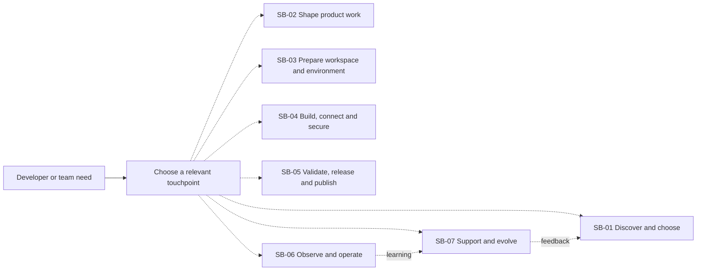

In the phase tables, **customer actions** sit above the line of interaction;
**visible DX touchpoints** are the frontstage. **Backstage** describes work or
automation not directly visible to the customer, and **supporting processes**
identify dependencies behind the line of internal interaction. A backstage row
does not imply that the DX team personally performs every operation.

## SB-01 Discover and choose

**Use Cases:** [UC-01 Consult and retrieve DX guidance](use-cases/uc-01-consult-guidance.md),
[UC-02 Discover and invoke DX capabilities](use-cases/uc-02-discover-invoke-capabilities.md),
[UC-22 Assess a technology against adoption guidance](use-cases/uc-22-assess-adoption-guidance.md).

| Layer | Journey and evidence |
| --- | --- |
| Customer actions | **[D]** A developer or delegated agent searches guidance, discovers a capability or checks adoption advice for a choice. |
| Visible DX touchpoints | **[D]** Published guidance, a question or search result, source references where available, and capability descriptions. **[R]** An absent verifiable source is reported explicitly without a factual answer; unavailable adoption guidance is not presented as approval. |
| Backstage | **[D]** DX maintains shared guidance and capabilities; knowledge retrieval and capability discovery use their respective source material. |
| Supporting processes | Documentation sources, knowledge retrieval, agent or human interfaces, and applicable authorization. |
| Handoffs and outcomes | **[D]** The actor can inspect guidance and available operations. **[R]** New choices wait for available adoption guidance or authorized confirmation; documented existing choices may continue with the gap explicit. |
| Friction hypothesis | **[H]** Unclear provenance or unavailable guidance could interrupt a developer or agent. Validate whether this occurs and where the journey resumes. |

## SB-02 Shape product work

**Use Case:** [UC-20 Guide a product initiative with agentic workflows](use-cases/uc-20-guide-product-initiative.md).

| Layer | Journey and evidence |
| --- | --- |
| Customer actions | **[D]** When this optional workflow is useful, a product or delivery stakeholder, developer or delegated agent supplies evidence and requests a product or design artifact. |
| Visible DX touchpoints | **[D]** Linked product and design artifacts, separate Use Case pages, readiness decisions and a proposed work projection. A PRD is not a prerequisite for direct design intake. |
| Backstage | **[D]** Reusable agent guidance structures the artifacts and preserves links and identifiers. DX or another maintainer supplies that guidance. |
| Supporting processes | Source artifacts, agent capabilities, review and work-management systems. |
| Handoffs and outcomes | **[D]** Human reviewers confirm lifecycle promotions; a work projection consumes eligible ready Use Cases. External work-system changes require the workflow's stated confirmation. **[R]** Delegated agents remain within their authority and report outcomes; enforcement coverage remains unverified. |
| Friction hypothesis | **[H]** Missing evidence or unclear ownership could slow the transition from an idea to actionable work. Validate with the participating roles. |

## SB-03 Prepare workspace and environment

**Use Cases:** [UC-03 Bootstrap a development workspace](use-cases/uc-03-bootstrap-workspace.md),
[UC-04 Add a deployment environment](use-cases/uc-04-add-deployment-environment.md),
[UC-05 Start a reproducible development environment](use-cases/uc-05-start-development-environment.md),
[UC-06 Assess workspace conformance](use-cases/uc-06-assess-workspace-conformance.md).

| Layer | Journey and evidence |
| --- | --- |
| Customer actions | **[D]** A developer or authorized agent starts from a new or existing workspace, prepares a development or deployment environment, and checks its configuration. |
| Visible DX touchpoints | **[D]** Guided or supported structured inputs, workspace files, optional remote publication, environment metadata and individual conformance checks. **[R]** Required account authorization has an explicit per-account outcome; incomplete required work is not reported as full success. |
| Backstage | **[D]** Setup uses shared templates and checks, initializes applicable state and may request account authorization. DX maintains shared assets; the relevant account and repository owners retain their authority. |
| Supporting processes | Workspace and code collaboration, account identity and authorization, infrastructure state and development-environment configuration. |
| Handoffs and outcomes | **[D]** A local workspace can remain available without immediate publication; existing external prerequisites still apply. **[R]** A configured environment remains `partial` while required authorization is pending, failed or unverifiable; setup failures identify known or uncertain effects. |
| Friction hypothesis | **[H]** Separate prerequisites and approvals could make it difficult to tell whether an environment is ready. Validate where customers encounter uncertainty. |

## SB-04 Build, connect and secure

**Use Cases:** [UC-08 Plan and provision infrastructure](use-cases/uc-08-provision-infrastructure.md),
[UC-09 Grant scoped access to resources](use-cases/uc-09-grant-scoped-access.md),
[UC-10 Establish private connectivity across ownership boundaries](use-cases/uc-10-connect-across-ownership-boundaries.md),
[UC-11 Connect environments across cloud boundaries](use-cases/uc-11-connect-cloud-boundaries.md),
[UC-12 Integrate services securely](use-cases/uc-12-integrate-services.md),
[UC-24 Apply specialist agent guidance to engineering work](use-cases/uc-24-apply-specialist-agent-guidance.md).

| Layer | Journey and evidence |
| --- | --- |
| Customer actions | **[D]** A team or delegated agent declares infrastructure, requests scoped access, connects supported resources or applies specialist engineering guidance. |
| Visible DX touchpoints | **[D]** Reusable infrastructure abstractions, plans, permission intent, connection requests and results. **[R]** Agent outcomes are machine-readable where applicable and must not expose secrets. |
| Backstage | **[D]** Authorized execution interacts with resource, identity, network and state services; a destination owner approves the documented cross-owner connection. **[R]** The resource-owning team governs its permissions and applicable gates within common guardrails; enforcement evidence remains open. |
| Supporting processes | Shared abstractions, state persistence, identity and access, private connectivity, service-integration facilities and applicable approval systems. |
| Handoffs and outcomes | **[D]** A plan is separate from application, and connectivity alone does not grant application access. **[R]** Overlapping network ranges are rejected before connection-related changes; agents cannot increase their own privileges or disable controls. Delivery, ordering and recovery guarantees are not prescribed universally for service-integration patterns. |
| Friction hypothesis | **[H]** Distributed ownership or unclear resource-specific permissions could lead to repeated handoffs. Validate the actual sources of delay before changing the flow. |

## SB-05 Validate, release and publish

**Use Cases:** [UC-13 Validate and integrate a change](use-cases/uc-13-validate-change.md),
[UC-15 Release a service safely](use-cases/uc-15-release-service.md),
[UC-16 Version and publish reusable assets](use-cases/uc-16-publish-assets.md).

| Layer | Journey and evidence |
| --- | --- |
| Customer actions | **[D]** A team proposes a change, reviews validation results and releases a service. A shared-asset maintainer may separately prepare and publish a reusable version. |
| Visible DX touchpoints | **[D]** Check results, review or approval requests, staging and rollout outcomes, release information and lifecycle guidance. A warning is not automatically a required gate. |
| Backstage | **[D]** Configured automation runs relevant checks, stages or promotes a release, and publishes applicable shared assets. Reviewers and approval authorities participate only where policy requires them. |
| Supporting processes | Code and delivery systems, configured validation, target services, versioned artifacts and approval policies. |
| Handoffs and outcomes | **[D]** Staging does not change production traffic; a configured incremental rollout validates each step. **[R]** Automatic restoration is permitted only when authorized, safe and verified; incompatible contracts need a new major version and migration guidance. Target-specific health and rollout capabilities are not universal. |
| Friction hypothesis | **[H]** An unclear gate, rollback outcome or migration path could interrupt delivery. Validate whether teams can identify the next authorized action. |

## SB-06 Observe and operate

**Use Cases:** [UC-14 Detect infrastructure drift](use-cases/uc-14-detect-infrastructure-drift.md),
[UC-17 Observe a service and generate operational dashboards](use-cases/uc-17-observe-service.md),
[UC-18 Identify resource cost risks](use-cases/uc-18-identify-cost-risks.md),
[UC-19 Explore engineering and adoption metrics](use-cases/uc-19-explore-engineering-metrics.md).

| Layer | Journey and evidence |
| --- | --- |
| Customer actions | **[D]** A service or infrastructure operator examines drift, service signals or cost findings; an authorized reader explores engineering and adoption data. |
| Visible DX touchpoints | **[D]** Operational views, configured alerts, read-only cost reports and scoped metrics with available data ranges. **[R]** Missing signals are shown as unknown, and an incomplete drift inspection is not reported as no drift. |
| Backstage | **[D]** Supporting processes compare infrastructure state, collect service signals, inspect resource and usage data, and import engineering observations. Data and resource owners remain distinct roles. |
| Supporting processes | State, telemetry, resource inventory, analytics persistence, visibility controls and notification channels. |
| Handoffs and outcomes | **[D]** Cost findings prompt review and do not modify resources; an incomplete import window does not advance its cursor. **[R]** Incomplete drift inspection alerts the responsible owner; global metrics are restricted by the agreed data-owner and privacy policy. |
| Friction hypothesis | **[H]** Missing signals, uncertain import freshness or unavailable scoped data could be mistaken for a healthy or empty result. Validate how operators interpret these outcomes. |

## SB-07 Support and evolve

**Use Cases:** [UC-07 Apply a supported migration](use-cases/uc-07-apply-migration.md),
[UC-21 Compare agent capability quality](use-cases/uc-21-compare-agent-capability.md),
[UC-23 Obtain support and contribute improvements](use-cases/uc-23-obtain-support-contribute.md).
Shared-asset publication in [UC-16](use-cases/uc-16-publish-assets.md) can
also occur as part of this feedback loop.

| Layer | Journey and evidence |
| --- | --- |
| Customer actions | **[D]** A team seeks help, reports a problem, contributes or applies an available migration. A capability maintainer may evaluate a changed agent capability. |
| Visible DX touchpoints | **[D]** The primary support channel, contribution path, lifecycle information, migration catalog and evaluation report. **[R]** An unavailable primary support channel is reported without automatic fallback. |
| Backstage | **[D]** Maintainers review contributions and support requests, maintain shared assets and compare evaluation results. The DX team may perform these roles; another contributing team may also be a maintainer. |
| Supporting processes | Support and collaboration systems, release and migration processes, evaluation inputs and evidence. |
| Handoffs and outcomes | **[D]** A known migration can change a workspace; failed work can leave partial effects. **[R]** Incomparable evaluation runs are identified rather than presented as valid deltas, and incompatible contract changes have a documented migration path. |
| Friction hypothesis | **[H]** An unavailable support channel or an unclear migration path could leave a team without a next step. Validate frequency and impact before prioritizing changes. |

## Actor journeys

These are role-specific views of the same phases, not separate mandated
processes. Dotted arrows are optional or recurring paths. Each journey is
derived from the linked Use Cases; it is not evidence that a specific person
has followed it.

### Product SWE team

**Goal:** develop and operate services using DX where it is useful and
authorized. **Relationship:** primary customer.

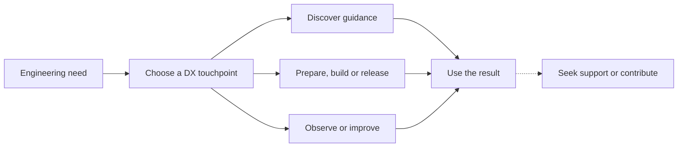

**Journey:** enter through [discovery](#sb-01-discover-and-choose),
[workspace setup](#sb-03-prepare-workspace-and-environment),
[engineering work](#sb-04-build-connect-and-secure),
[delivery](#sb-05-validate-release-and-publish) or
[operations](#sb-06-observe-and-operate); interpret results and optionally
return through [support and evolution](#sb-07-support-and-evolve).
The same team can also own resources or provide reviewers.

### Coding agent

**Goal:** carry out delegated work for a team; the developer remains the
customer.

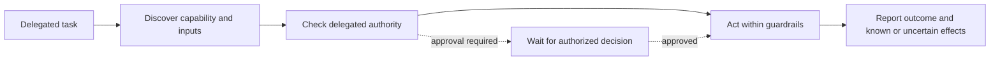

**Journey:** obtain guidance and a supported interface, act within delegated
authority, and report outcomes or required approvals. **[R]** Self-escalation,
disabling controls and unverified machine-readable coverage remain subject to
implementation evidence. See [SB-01](#sb-01-discover-and-choose),
[SB-04](#sb-04-build-connect-and-secure) and
[SB-07](#sb-07-support-and-evolve).

### DX team

**Goal:** provide, maintain and support the shared offering.

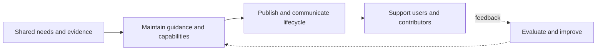

**Journey:** maintain shared touchpoints and guardrails, support their use,
review contributions and evolve assets. A shared-asset or agent-capability
maintainer can also belong to another team; DX does not automatically operate
each customer's service. See [SB-01](#sb-01-discover-and-choose),
[SB-05](#sb-05-validate-release-and-publish) and
[SB-07](#sb-07-support-and-evolve).

### Product or delivery stakeholder

**Goal:** turn product evidence into reviewable work and inspect relevant
outcomes; this role is a secondary user or stakeholder, not a primary DX
customer.

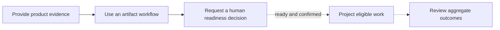

**Journey:** use the optional [product-work flow](#sb-02-shape-product-work)
and, where authorized data and definitions are available, review
[outcomes](#sb-06-observe-and-operate). A PRD is not required for direct
design intake, and proposing work does not itself mutate an external system.

### Service or infrastructure operator

**Goal:** change and operate an authorized service or infrastructure scope.

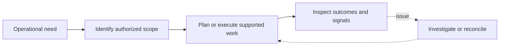

**Journey:** use [engineering](#sb-04-build-connect-and-secure),
[delivery](#sb-05-validate-release-and-publish) and
[operations](#sb-06-observe-and-operate) as appropriate. A plan, an
approval and an applied change remain distinct; recovery does not imply
universal automatic rollback.

### Resource owner

**Goal:** govern access and approval within the owned resource boundary.

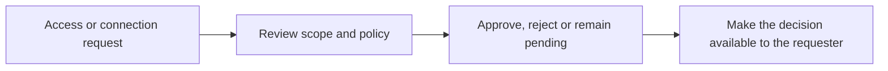

**Journey:** **[R]** set resource-specific permissions and applicable gates
within common DX guardrails. **[D]** In the documented cross-owner connection,
the destination owner reviews the request. This role is not automatically the
data owner. See
[SB-03](#sb-03-prepare-workspace-and-environment) and
[SB-04](#sb-04-build-connect-and-secure).

### Data owner

**Goal:** govern the classification, retention and sharing of a dataset.

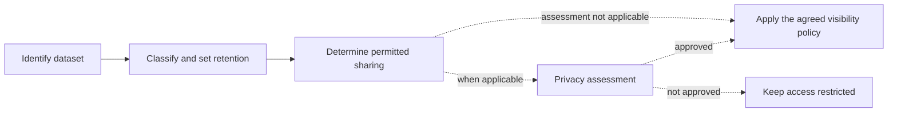

**Journey:** **[R]** classify data and define retention under applicable
policies; for global metrics, determine whether limited scopes may access a
dataset and obtain privacy assessment where applicable. Actual assignments,
classification and enforcement evidence remain open. See
[SB-06](#sb-06-observe-and-operate) and
[data lifecycle](design-review.md#data-lifecycle-and-audit).

### Reviewer or approval authority

**Goal:** make an authorized decision when a review or approval gate applies.

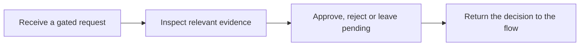

**Journey:** review only the changes, access requests or artifact promotions
for which a gate applies; return the decision so the requesting actor can
continue or stop. A reviewer is not necessarily the resource owner. See
[SB-02](#sb-02-shape-product-work),
[SB-04](#sb-04-build-connect-and-secure) and
[SB-05](#sb-05-validate-release-and-publish).

### Security and privacy functions

**Goal:** assess their respective controls and data concerns before
production.

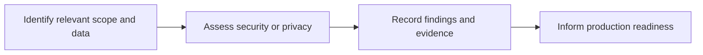

**Journey:** **[R]** assess the applicable security and privacy baseline with
DX and the relevant owners. No completed assessment or named specialist owner
is established by the current sources. See
[SB-04](#sb-04-build-connect-and-secure),
[SB-06](#sb-06-observe-and-operate) and
[open.item-003](design-review.md#open-questions-assumptions-decisions-and-change-propagation).

### Downstream service consumer

**Goal:** use a product team's service; this role is indirectly affected by DX
but is not identified as a direct DX customer.

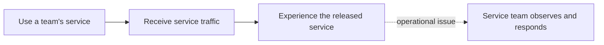

**Journey:** a release or operational issue can affect the consumer while the
service team uses DX delivery and observability capabilities. No direct DX
touchpoint or observed customer sentiment is asserted. See
[SB-05](#sb-05-validate-release-and-publish) and
[SB-06](#sb-06-observe-and-operate).

## Example cross-role handoff

This example shows a possible authorized infrastructure change; the approval
step applies only when the relevant policy requires it.

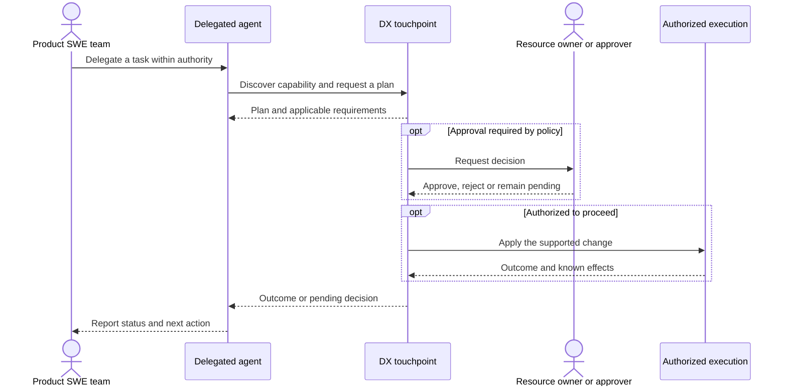

**[R]** The agreed `success` / `partial` / `failed` outcomes, agent
guardrails and safe recovery behavior require implementation evidence; this
diagram does not claim that every current interface enforces them.

## Use Case coverage

Each Use Case has one primary blueprint step for navigation. Other phases and
role journeys can also apply; this table does not imply a dependency or
mandatory ordering.

| Use Case | Primary blueprint step |
| --- | --- |
| [UC-01 Consult and retrieve DX guidance](use-cases/uc-01-consult-guidance.md) | [SB-01 Discover and choose](#sb-01-discover-and-choose) |
| [UC-02 Discover and invoke DX capabilities](use-cases/uc-02-discover-invoke-capabilities.md) | [SB-01 Discover and choose](#sb-01-discover-and-choose) |
| [UC-03 Bootstrap a development workspace](use-cases/uc-03-bootstrap-workspace.md) | [SB-03 Prepare workspace and environment](#sb-03-prepare-workspace-and-environment) |
| [UC-04 Add a deployment environment](use-cases/uc-04-add-deployment-environment.md) | [SB-03 Prepare workspace and environment](#sb-03-prepare-workspace-and-environment) |
| [UC-05 Start a reproducible development environment](use-cases/uc-05-start-development-environment.md) | [SB-03 Prepare workspace and environment](#sb-03-prepare-workspace-and-environment) |
| [UC-06 Assess workspace conformance](use-cases/uc-06-assess-workspace-conformance.md) | [SB-03 Prepare workspace and environment](#sb-03-prepare-workspace-and-environment) |
| [UC-07 Apply a supported migration](use-cases/uc-07-apply-migration.md) | [SB-07 Support and evolve](#sb-07-support-and-evolve) |
| [UC-08 Plan and provision infrastructure](use-cases/uc-08-provision-infrastructure.md) | [SB-04 Build, connect and secure](#sb-04-build-connect-and-secure) |
| [UC-09 Grant scoped access to resources](use-cases/uc-09-grant-scoped-access.md) | [SB-04 Build, connect and secure](#sb-04-build-connect-and-secure) |
| [UC-10 Establish private connectivity across ownership boundaries](use-cases/uc-10-connect-across-ownership-boundaries.md) | [SB-04 Build, connect and secure](#sb-04-build-connect-and-secure) |
| [UC-11 Connect environments across cloud boundaries](use-cases/uc-11-connect-cloud-boundaries.md) | [SB-04 Build, connect and secure](#sb-04-build-connect-and-secure) |
| [UC-12 Integrate services securely](use-cases/uc-12-integrate-services.md) | [SB-04 Build, connect and secure](#sb-04-build-connect-and-secure) |
| [UC-13 Validate and integrate a change](use-cases/uc-13-validate-change.md) | [SB-05 Validate, release and publish](#sb-05-validate-release-and-publish) |
| [UC-14 Detect infrastructure drift](use-cases/uc-14-detect-infrastructure-drift.md) | [SB-06 Observe and operate](#sb-06-observe-and-operate) |
| [UC-15 Release a service safely](use-cases/uc-15-release-service.md) | [SB-05 Validate, release and publish](#sb-05-validate-release-and-publish) |
| [UC-16 Version and publish reusable assets](use-cases/uc-16-publish-assets.md) | [SB-05 Validate, release and publish](#sb-05-validate-release-and-publish) |
| [UC-17 Observe a service and generate operational dashboards](use-cases/uc-17-observe-service.md) | [SB-06 Observe and operate](#sb-06-observe-and-operate) |
| [UC-18 Identify resource cost risks](use-cases/uc-18-identify-cost-risks.md) | [SB-06 Observe and operate](#sb-06-observe-and-operate) |
| [UC-19 Explore engineering and adoption metrics](use-cases/uc-19-explore-engineering-metrics.md) | [SB-06 Observe and operate](#sb-06-observe-and-operate) |
| [UC-20 Guide a product initiative with agentic workflows](use-cases/uc-20-guide-product-initiative.md) | [SB-02 Shape product work](#sb-02-shape-product-work) |
| [UC-21 Compare agent capability quality](use-cases/uc-21-compare-agent-capability.md) | [SB-07 Support and evolve](#sb-07-support-and-evolve) |
| [UC-22 Assess a technology against adoption guidance](use-cases/uc-22-assess-adoption-guidance.md) | [SB-01 Discover and choose](#sb-01-discover-and-choose) |
| [UC-23 Obtain support and contribute improvements](use-cases/uc-23-obtain-support-contribute.md) | [SB-07 Support and evolve](#sb-07-support-and-evolve) |
| [UC-24 Apply specialist agent guidance to engineering work](use-cases/uc-24-apply-specialist-agent-guidance.md) | [SB-04 Build, connect and secure](#sb-04-build-connect-and-secure) |

## Validation and open evidence

- **[H] Journey and friction validation:** the DX Product Owner should
  validate the reconstructed role journeys, handoffs and friction hypotheses
  with developer customers and the participating roles. No interviews or
  observed sentiment are claimed.
- **[R] Implementation evidence:** the agreed behaviors identified above
  remain subject to the design review's
  [coverage](design-review.md#open-questions-assumptions-decisions-and-change-propagation),
  authorization, contract, security and recovery gaps.
- **[D] Measurement:** the design review defines aggregate outcome indicators
  and a quarterly review, but their sources, baselines and targets are not yet
  established. No numerical performance or capacity objectives are added by
  this blueprint.
