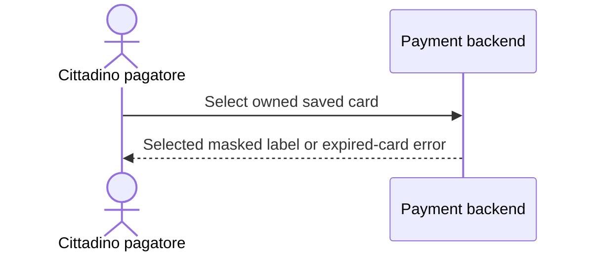

# UC-01: Select a saved card

**Linked JTBD**: PRD-payments/JTBD-01

**Primary actor**: Cittadino pagatore

**Secondary actors**: N/A - only the payer participates.

**Source artifact**: [PRD-payments](prd-payments.md); synthetic product and
engineering reviewers confirmed ready on 2026-09-15.

**Service Blueprint step**: Choose saved card; see DR design evidence.

**Domain entities**: Saved card, Payment session.

**Trigger**: Payer opens saved cards for an unpaid payment session.

**Preconditions**: Signed in; session and active saved card belong to the payer.

**Main flow**: List masked cards; payer selects one; backend validates the token
and associates the card with the session; show the selected masked label.

**Alternate flows**: N/A - new-card registration is outside this UC.

**Exception flows / edge cases**: Expired token -> `SAVED_CARD_EXPIRED`;
show rejection and leave selection unchanged.

**Postconditions**: Session contains the selected card on success; no charge.

**Errors**: `SAVED_CARD_EXPIRED`: expired token -> rejected, selection unchanged.

**Acceptance checks**:

- `AC-UC-01-01`: Selecting an owned active card associates it with the session
  and displays its masked label.
- `AC-UC-01-02`: Selecting an expired card reports `SAVED_CARD_EXPIRED` and
  leaves the previous selection unchanged.

**Tracking events**: `saved_card_selected`, mobile, on success, for selection KPI;
confirmed in DR control evidence.

**Relevant links**: `solution.components.item-001`, `contracts.item-001`
in [DR-01](design-review-payments.md); Figma N/A per DR design evidence;
canonical UC URL snapshot: https://example.org/use-cases/select-saved-card.
Validation: active/expired-card tests planned under DR delivery evidence.

## Open questions and propagation

No behavior-local gaps; parent `open.item-001` remains non-blocking.
