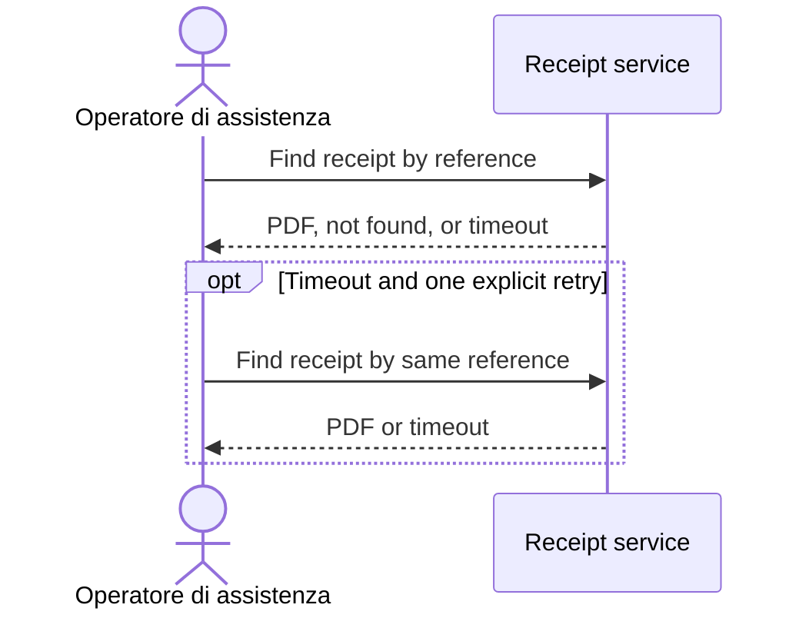

# UC-02: Find payment receipt

**Linked JTBD**: PRD-payments/JTBD-02

**Primary actor**: Operatore di assistenza

**Secondary actors**: N/A - only the authorized operator participates.

**Source artifact**: [PRD-payments](prd-payments.md); synthetic product and
engineering reviewers confirmed the retry addition ready on 2026-09-15.

**Service Blueprint step**: Find receipt by payment reference; see DR design evidence.

**Domain entities**: Payment, Receipt.

**Trigger**: Operator submits a payment reference for receipt lookup.

**Preconditions**: Signed in as an authorized support operator.

**Main flow**: Operator enters reference; receipt service authorizes lookup and
returns the receipt PDF; operator downloads it for the support request.

**Alternate flows**: After a timeout, one explicit retry repeats the same
reference once; success returns the PDF. No automatic retry.

**Exception flows / edge cases**: Missing receipt -> `RECEIPT_NOT_FOUND`;
timeout (including retry timeout) -> `RECEIPT_LOOKUP_UNAVAILABLE`.
Show the error and leave Payment unchanged; missing receipt is not retryable.

**Postconditions**: Receipt available on success; settled Payment never changes.

**Errors**:

- `RECEIPT_NOT_FOUND`: no receipt -> show not found; Payment unchanged.
- `RECEIPT_LOOKUP_UNAVAILABLE`: timeout -> show unavailable; Payment unchanged.

**Acceptance checks**:

- `AC-UC-02-01`: An authorized lookup of a reference with a receipt returns its PDF.
- `AC-UC-02-02`: An authorized lookup of a reference without a receipt shows
  `RECEIPT_NOT_FOUND` and leaves the Payment unchanged.
- `AC-UC-02-03`: After a timeout, one explicit retry repeats the same reference
  once; success returns the PDF, another timeout shows
  `RECEIPT_LOOKUP_UNAVAILABLE`; Payment is unchanged and no automatic retry occurs.

**Tracking events**: `support_receipt_found`, web, only on success, for lookup KPI;
confirmed in DR control evidence.

**Relevant links**: `solution.components.item-002`, `contracts.item-002`
in [DR-01](design-review-payments.md); Figma N/A per DR design evidence;
canonical UC URL snapshot: https://example.org/use-cases/find-payment-receipt.
Validation: authorized, not-found, and timeout/retry tests planned in DR.

## Open questions and propagation

Retry is propagated from PRD to DR and this child; prior Jira items require
synchronization only when their snapshot is supplied. Existing acceptance
meanings `AC-UC-02-01` and `AC-UC-02-02` are unchanged.
