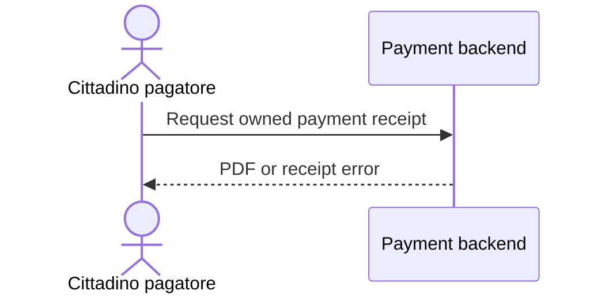

# UC-02: Download payment receipt

**Linked JTBD**: PRD-saved-payments/JTBD-02

**Primary actor**: Cittadino pagatore

**Secondary actors**: N/A - no other product actor participates.

**Source artifact**: [PRD-saved-payments](prd-saved-payments.md#uc-02-source-behavior).

**Service Blueprint step**: N/A - approved PRD flow is the source.

**Domain entities**: Payment, Receipt.

**Trigger**: The payer requests a receipt from a completed payment.

**Preconditions**: Signed in; the completed Payment belongs to the payer.

**Main flow**:

1. The payer opens a completed payment and requests its receipt.
2. The backend authorizes access and returns the receipt as a PDF.
3. The payer downloads the PDF.

**Alternate flows**: N/A - no alternate successful route is defined.

**Exception flows / edge cases**:

- `E1`: No receipt exists -> Error: `RECEIPT_NOT_FOUND`; show unavailable.
- `E2`: Generation times out -> Error: `RECEIPT_UNAVAILABLE`; show unavailable.

**Postconditions**: PDF downloaded on success; Payment unchanged in every outcome.

**Errors**:

- `RECEIPT_NOT_FOUND`: no receipt exists -> show unavailable; Payment unchanged.
- `RECEIPT_UNAVAILABLE`: generation timeout -> show unavailable; Payment unchanged.

**Acceptance checks**:

- `AC-01`: For an owned completed Payment with an available Receipt, requesting
  it downloads a PDF. Evidence: PDF-response test planned.
- `AC-02`: For an owned completed Payment without a Receipt, requesting it shows
  `RECEIPT_NOT_FOUND` and does not change the Payment. Evidence: missing-receipt test planned.

**Tracking events**: `receipt_downloaded`, after successful PDF response,
channel = mobile, source = PRD discovery evidence, purpose = receipt-access
monitoring, status = confirmed.

**Relevant links**:

- Sequence diagram: inline below.
- Figma / Service Blueprint: N/A - existing screens and approved PRD flow.
- DR components: `solution.components.item-001` in [DR-02](design-review-retry.md).
- Endpoint: `contracts.item-001`, `GET /payments/{id}/receipt` in DR-02.
- Validation evidence: planned PDF-response and missing-receipt tests, not executed.

## Open questions and propagation

See parent `open.item-001` for pending retry propagation; do not duplicate it here.
